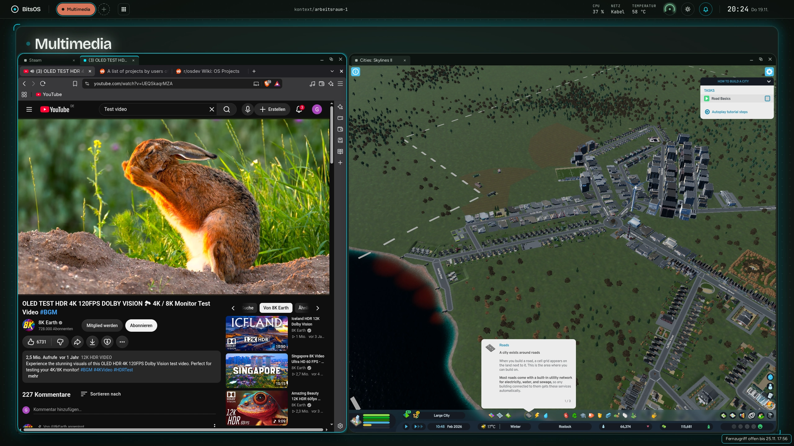
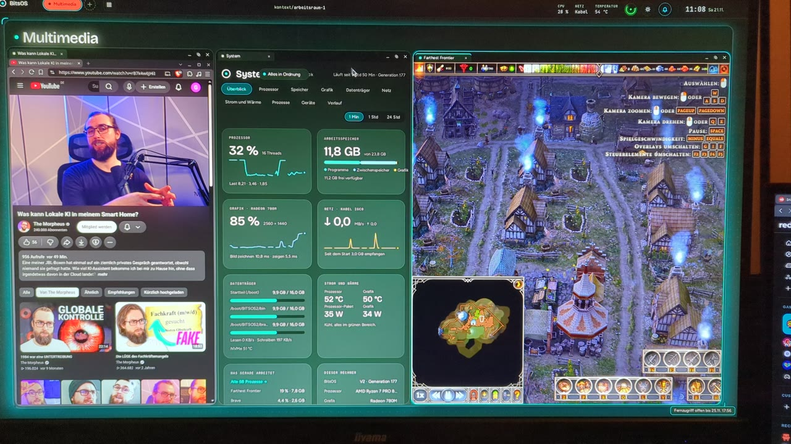
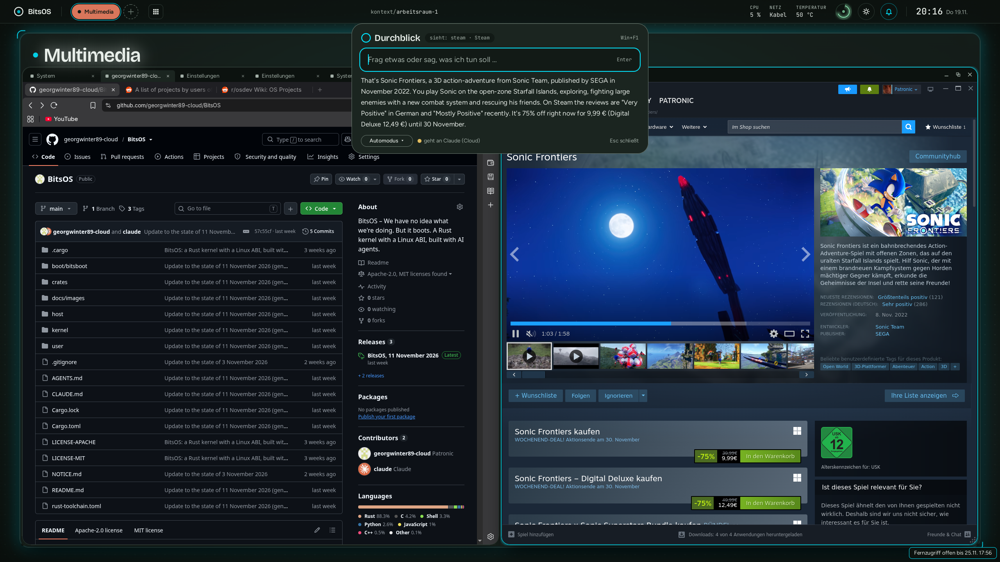
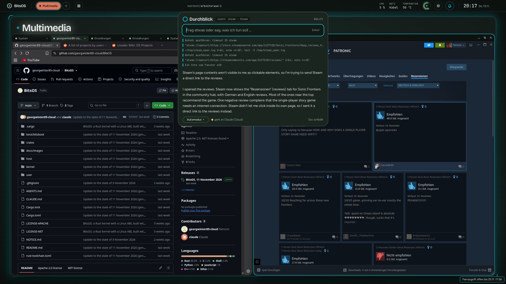
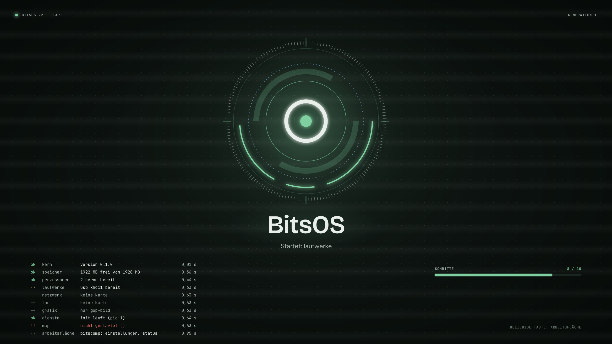
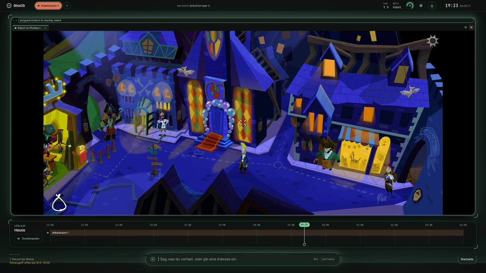

https://github.com/user-attachments/assets/b50625db-2c75-4882-8c71-fc459383d333

# BitsOS

We have no idea what we're doing.<br>
But it boots.<br>
...on two real PCs, not just in a virtual machine.<br>
...and plays sounds.<br>
...and connects to the internet, by cable and by Wi-Fi.<br>
...and runs Brave, in its own sandbox.<br>
...and plays YouTube in Brave next to a city in Cities: Skylines II.<br>
...and opens LibreOffice.<br>
...and logs in to Steam.<br>
...and plays Return to Monkey Island.<br>
...and plays Windows games through Proton.<br>
...and draws with its own driver on a real GPU.<br>
...and has an assistant that reads the screen and opens things for you.<br>
...and updates itself with signed versions.<br>
...and survives its own kernel panic.<br>
...and wakes up an RX 9070 XT with its own driver, step for step as Linux does.<br>
...and somehow it still boots.

---



*Cities: Skylines II (through Steam and Proton) beside YouTube in Brave, on the Mini-PC's Radeon 780M, 19 November
2026.*

[](docs/videos/bitsos-minipc-2026-11-21.mp4)

*A one-minute video, filmed off the monitor on 21 November 2026: YouTube in Brave, BitsOS's system page and
Farthest Frontier side by side on the Mini-PC. Click the picture to open the video.*

BitsOS is an operating system with its own kernel, written in Rust. To programs it speaks Linux: it implements 278 of
the 386 system calls of Linux 7.3.1 on x86-64, so ordinary Linux programs (the Brave browser, LibreOffice, Valve's
Steam client and, through Proton, Windows games) run on it unchanged, with no Linux underneath. It has its own boot
loader, its own drivers, its own desktop and its own assistant, and it runs on two real machines. It is a hobby
project and an experiment: Georg decides what it should be, and AI agents (Anthropic's Claude) write, check and test
the code.

If you want to try it, read [Trying BitsOS](#trying-bitsos) first. If an AI coding agent helps you, point it at
[`AGENTS.md`](AGENTS.md).

**Contents:** [Pictures](#pictures) · [What runs today](#what-runs-today) · [The hardware](#the-hardware) ·
[What is inside](#what-is-inside) · [How it is built](#how-it-is-built) · [The graphics drivers](#the-graphics-drivers) ·
[Recent milestones](#recent-milestones) · [Numbers](#numbers) · [What does not work (yet)](#what-does-not-work-yet) ·
[Trying BitsOS](#trying-bitsos) · [Building and testing](#building-and-testing) · [Licence](#licence-and-notices)

## Pictures

Durchblick is BitsOS's assistant. Win+F1 opens it over whatever is on the screen; it sees which program is in front.

| "What is this game?" | "Open the reviews" |
|---|---|
|  |  |
| Asked about the Steam page in front, it says which game it is, what the reviews say and what it costs. | Asked to open the reviews, it found it could not click inside Steam's page, sent Steam a direct link instead, and said so. |

*Both on the Mini-PC, 19 November 2026, with Claude as the AI provider. The labels are German, as on the machine.*



*The boot screen lists each start step as it happens; on the Mini-PC it hands over to the desktop without a jump, in
QEMU to the text console. This picture is a QEMU test run in the middle of the start (step 8 of 10), with QEMU's
default machine (no network card, no sound card) and no remote-control setup, so those rows are not green.*



*Return to Monkey Island, the native Linux version, from Steam on the Mini-PC, 5 November 2026: the first game that ran
on BitsOS.*

## What runs today

Everything in this section has been seen working on the real machine named, not only in an emulator.

**On the Mini-PC** (Ryzen 7 PRO 8845HS, Radeon 780M):

- **Its own desktop** (`bitscomp`, a Wayland compositor), drawn on the GPU by BitsOS's own 780M driver: a boot screen
  that shows each start step, workspaces, windows side by side, a program library (the Windows key or a gamepad
  opens it), dark and light themes. Labels are German.
- **Brave**, in its own sandbox (Brave's sandbox page is all green, a crashing tab stays contained), with **YouTube**.
- **LibreOffice**: a Writer document typed and saved.
- **Steam**, Valve's unmodified 64-bit client: it installs and updates itself, logs in, shows its store and library and
  downloads games.
- **Games** from Steam:
  - Windows games through **Proton** (WoW64 mode, so 32-bit Windows games need no 32-bit Linux) and DXVK on the
    780M's Vulkan driver: **Cities: Skylines II**, **Farthest Frontier**, and two 32-bit games, **Dungeon Keeper 2**
    and **KKND2**.
  - **Return to Monkey Island**, the native 64-bit Linux version, in Steam's runtime container.
- **Durchblick**, the assistant (Win+F1): it sees which program is in front, answers questions about what is on the
  screen, and can act on its own, running commands and operating programs. It has three levels: only answer, ask
  first, or automatic. It talks to an AI provider you add yourself on the settings page "KI"; on the Mini-PC that is
  Claude. Adapters for the OpenAI API, Gemini and local OpenAI-compatible servers exist too, but only Claude has been
  tried on the machine.
- **Network**: wired (Intel I226) and Wi-Fi (Realtek RTL8852BE, WPA2).
- **Sound** over HDMI and DisplayPort, and USB audio.
- **Storage**: the USB stick, and BitsOS's own partitions on the internal NVMe drive beside Windows: it boots from its
  own EFI system partition there and keeps its data in a second one. It never writes anywhere else on that drive.
- **Updates over the network**: a new version is checked against its Ed25519 signature, installed as a new
  generation and tried once; the previous version stays installed to go back to.
- **Crashes**: after a kernel panic the machine comes back to BitsOS by itself in about two minutes, and the boot
  loader falls back to the last good version when a new one does not come up.

**On the Gaming-PC** (Core Ultra 7 265K, Radeon RX 9070 XT):

- BitsOS boots in a **safe mode** made for this PC from its own partition on an NVMe drive. It never even reads the
  drives that hold Windows and Linux.
- **Wired network** (Realtek RTL8126A, at 1 Gb/s on this network), **remote control** for the agents, and new
  versions over the network, signed as on the Mini-PC.
- The screen shows the **firmware's picture** with BitsOS's report page and text console. BitsOS's own driver for the
  RX 9070 XT brings the card up the way Linux does (see [below](#amd-radeon-rx-9070-xt-the-gaming-pc)); the desktop on
  that card is the next goal.

*The games are their makers' and are not part of BitsOS or this repository: Cities: Skylines II (Colossal Order,
Paradox Interactive), Farthest Frontier (Crate Entertainment), Dungeon Keeper 2, KKND2, Return to Monkey Island
(Terrible Toybox). You need your own copies. Brave and Steam are fetched from their makers during installation.*

## The hardware

BitsOS runs on two machines. Everything else is untested and will very likely not boot or not get far
([On real hardware](#3-on-real-hardware) says what to expect).

| | Mini-PC | Gaming-PC |
|---|---|---|
| Processor | AMD Ryzen 7 PRO 8845HS (Zen 4, 8 cores, 16 threads) | Intel Core Ultra 7 265K (8 performance and 12 efficiency cores) |
| Graphics | Radeon 780M (RDNA 3, built into the processor; the BIOS gives it 8 GB) | Radeon RX 9070 XT (RDNA 4, 16 GB) |
| Network | Intel I226 2.5 GbE, Realtek RTL8852BE Wi-Fi | Realtek RTL8126A 5 GbE |
| Sound | HDMI/DisplayPort (HD Audio), USB audio | USB audio (devices found; not played yet) |
| Boot | its own EFI system partition on the internal NVMe, a USB stick as the rescue | its own EFI system partition on an NVMe drive, a USB stick as the rescue |
| Picture | 2560x1440, the desktop on the GPU | 2560x1440, the firmware's picture and the text console |

The automated tests run in QEMU (q35) on the development machine.

## What is inside

- **Kernel** (`kernel/`, `crates/`): memory management with a page cache, huge pages and compaction, a preemptive
  scheduler for all cores, processes and threads, a VFS with FAT32 and ext4, snapshots of the data volume, a kernel
  journal, seccomp, and user, PID, network, IPC and mount namespaces.
- **Drivers**, written for BitsOS: NVMe, xHCI USB (keyboards, mice, gamepads, mass storage, USB audio), Intel I226,
  Realtek RTL8126A, HD Audio over HDMI/DisplayPort, ACPI, and AMD graphics for two generations (the Radeon 780M and
  the RX 9070 XT) behind Linux's amdgpu interface. Only the Wi-Fi driver for the RTL8852BE is ported from Linux's
  rtw89 (see `NOTICE.md`).
- **Boot loader** (`boot/bitsboot`): a UEFI program with no menu of its own. It picks a system generation from
  `\BITSOS2\SYS\` by its markers, gives a new generation one try and falls back to the last confirmed one by itself.
  It never writes UEFI variables.
- **User space** (`user/`): init, `bitscomp` (Wayland compositor and desktop), `settingsd`, `bitsjournal`, `assist`
  (the assistant), `ctxd` (a local context index), `bitspkgd` (programs and updates), and ports of BusyBox, Brave,
  Cobalt, ffmpeg, bubblewrap, Xwayland and Mesa.
- **Remote control** (`crates/mcp`, `user/services/bitsmcp`, `host/mcp`): an MCP service, so an AI agent on another
  computer can read logs, inspect hardware, run programs and install a new generation. It speaks TLS with a key
  pairing confirmed at the machine's keyboard; full access is limited in time and only granted from that keyboard.
- **Tests and tools** (`host/xtask`, `host/tests`): unit tests, in-kernel tests and QEMU scenarios behind one
  command, and check lists for the real machines.

## How it is built

Georg is a power user: he knows how a computer fits together, from the firmware up to the desktop, and he does not
write the code himself. His part:

- **Architecture and principles.** No fixed limits that are raised step by step later: memory, connections, programs
  and cores are dynamic from the start, as on Linux. The model is always the newest Linux. As much as possible in
  Rust; big third-party programs such as Brave or Steam stay as they are.
- **Design and ideas.** He designed the desktop (green, with a real boot screen), the idea of saying what you are
  about to do and getting the matching pieces laid out, with history and rewind, the assistant, and a couch mode for
  playing from the sofa.
- **Tools for the agents.** BitsOS's own remote access (MCP), so the agents test on the real machines themselves, and
  the measurement program for the graphics card.
- **Order and limits.** What comes first, and what the software must never do (for example change the graphics
  card's power limit, or write to the Windows drive).
- **What needs eyes, ears and hands.** The picture, the sound, the controls, and everything that for safety only
  works from the real keyboard. Most other checks on the real machines the agents run themselves, through the remote
  control: they start programs, read logs and measure.

Claude agents do the rest, in a fixed process:

1. **The desk**: one Claude session plans, hands out the work, merges and builds the versions. Georg talks to it.
2. **Waves** of three to five items. For each item a **scout** reads Linux's source and the existing code and draws a
   map, a **builder** builds the item in its own git worktree, **three checkers** look for bugs independently, each
   through its own lens (the Linux comparison, safety, tests), and a **fixer** checks every finding and fixes the
   real ones.
3. **Integration**: an integrator merges the wave and runs the **full test run** once, every test in QEMU and on the
   host. Zero compiler warnings, no skipped tests: a test that cannot do its work fails.
4. **A version**: the desk builds it and signs it.
5. **The hardware round** on the real machines.

Big third-party programs are tested on the real machines only. No human has read all of the code: it is backed by
tests, independent AI checkers and the real hardware.

## The graphics drivers

Both drivers are BitsOS's own, written in Rust. Programs see Linux's amdgpu interface (`/dev/dri/renderD128`), so
Mesa's Vulkan driver RADV and its OpenGL driver radeonsi run unchanged on top.

### AMD Radeon 780M (the Mini-PC)

- The driver brings the chip up at every boot (security processor, firmware, graphics, compute and copy engines,
  memory) and proves its memory and job paths before the render node appears.
- **Vulkan** through RADV: DXVK and the Windows games above, vkQuake and `vkcube`.
- **OpenGL** through radeonsi: the desktop's own renderer, Xwayland with glamor, Return to Monkey Island.
- The desktop draws only on the GPU and shows its frames without a copy (direct scanout, page flips, a hardware
  cursor, sound over the display).
- A ladder for GPU hangs exists (stop the shader, reset the queue, start the graphics block again), most of it proven
  only on a simulated chip. When it cannot help, the desktop ends, the text console takes over, and the machine needs
  a restart.

### AMD Radeon RX 9070 XT (the Gaming-PC)

A modern graphics card has its own security processor, a power controller with its own firmware and dozens of blocks
that each want to be woken in exactly the right order. There is no public manual for that, only Linux's driver. So on
18 November Georg recorded under Linux what Linux's amdgpu driver does to the card at a cold start: a trace of 492,096
events, among them about 227,000 register reads and writes, none lost. The driver was then built step by step, each
step checked against that recording on a simulated card that answers like the real one.

On the real card, BitsOS's own driver now brings the card up **the same way Linux's start does**. Georg starts a
measurement program at the Gaming-PC's keyboard; it runs every stage, writes a protocol after each one and switches
the PC off. On 20 November all 21 stages passed in 1.6 seconds of card time, each one matching Linux's recorded
start, and none of the protocol's checks against Linux's trace failed:

- the **security processor** booted its secure OS, and the **firmware** of the card's blocks loaded through it;
- the **power controller** (SMU) started with Linux's own sequence of messages; the card's power limit is never touched;
- the **graphics block**, its command processor and the **MES** scheduler firmware running, the kernel queues mapped
  through it;
- **ring tests** on the graphics ring and the four compute rings, with jobs whose fences come back through the
  interrupt ring, and a queue taken down and mapped again;
- both **copy engines** (SDMA) filling, copying and signalling;
- a thermal guard was on throughout: it switches the PC off in order, as Linux does, if the card overheats (it did
  not: the hotspot stayed at 61 °C).

What is not there yet: the display side, memory management for the card's VRAM and the path Mesa needs to submit
work. **The desktop on the RX 9070 XT is the next goal**; until then the Gaming-PC shows the firmware's picture with
the text console.

## Recent milestones

- **26 October 2026**: the first public release.
- **5 November**: the first game, Return to Monkey Island from Steam, on the 780M.
- **6 November**: Windows games through Proton; BitsOS boots from its own partition on the internal NVMe.
- **11 November**: 32-bit Windows games (Dungeon Keeper 2, KKND2), much faster loading, the program library.
- **15 November**: the Gaming-PC runs BitsOS in its safe mode, with cable network and remote control.
- **18 November**: Linux's start of the RX 9070 XT recorded; the desktop now draws on the GPU only.
- **19 November**: Cities: Skylines II; Durchblick reads the screen and acts; the first run of the RX 9070 XT driver
  on the real card: all 16 stages of that day passed, matching Linux.
- **20 November**: the second run on the real card: all 21 stages, now with the command processor, MES and the ring
  tests.

## Numbers

As of 20 November 2026, for BitsOS V2 (the Rust version, started on 14 October 2026: 37 days). Before it there was a
first version in assembly, a dead end because nobody else's programs ran on it.

| | |
|---|---|
| Commits | 3,136 in the development repository |
| Rust code | about 970,000 lines in about 3,500 files, tests included, plus about 142,000 lines of register tables generated from Linux's headers |
| Tests | 1,695 in-kernel tests, 7,737 host tests, about 200 QEMU scenario scripts |
| Crates | 68 in `crates/`, 16 of them drivers |
| Versions | up to version 177, each signed and installable over the network |
| System calls | 278 of 386 (Linux 7.3.1, x86-64) |

## What does not work (yet)

So nobody gets the wrong idea:

- **Two machines.** Other hardware is untested and will very likely not boot or not get far: the desktop needs the
  780M's driver, only a few network cards have a driver, laptops' built-in keyboards and touchpads are not
  supported, and there is no SATA driver.
- **The RX 9070 XT has no desktop yet**: the card comes up, but nothing is drawn with it.
- **QEMU shows no desktop.** The desktop draws only on the GPU, and QEMU has no graphics chip BitsOS drives: in a
  window you see the boot screen and then the text console.
- **No 32-bit Linux programs**, so native 32-bit games do not run (32-bit Windows games through Proton do).
- **108 Linux system calls are missing**, `io_uring` among them.
- **Games with anti-cheat** have not been tried, on purpose. Few games have been tried at all.
- **Web addresses** do not open from the desktop's address bar yet; open them in Brave.
- **Not secure, not stable.** It is an experiment. No human has read all of the code. Please do not use it for
  anything that matters.

## Trying BitsOS

BitsOS is an experiment. It is not secure and not stable. On a real machine, use one whose disks hold nothing you
would miss, and back them up anyway. The easiest way to look at it is the installer's QEMU mode (next section): one
command, and BitsOS runs in a window without touching any disk. The same installer makes a stick for a real machine
from a release without building anything (the section after it).

The newest release is **V = `2026-11-20`** (tag `v2026-11-20`); its installers are
`bitsos-install-2026-11-20-linux-x86_64` and `bitsos-install-2026-11-20-windows-x86_64.exe`. Below, `<V>` stands for
the version you downloaded.

What BitsOS does to disks, by design:

- It writes only below `\BITSOS2\` on its own boot volume, and only when that volume proves it is the boot volume
  (its `\BITSOS2\STICK.ID` equals the one the loader read, its label is `BITSOS`, and the other rules in section 8).
- Every other disk is read-only: internal NVMe drives, other USB disks, everything. It has no SATA driver at all.
- It never writes a partition table, a boot sector or a UEFI variable.
- The only way to open part of an internal drive for writing is the guarded CONFIG keys of section 6. BitsOS itself
  never sets them: you set them by hand, on another computer, in the stick's `CONFIG.TXT`.

Building it yourself needs an Arch Linux or CachyOS host. Every command below comes from this repository's code
(`host/xtask`, `host/mcp`, `host/installer`). The path from a fresh clone on another person's machine has not been
tried yet: expect to adapt a path or install a package we did not list, and please tell us what you had to change.

### The easiest way: BitsOS in a window, one command, nothing to build

Download the installer of the release you want from `https://github.com/georgwinter89-cloud/BitsOS/releases` (the
files of release `<V>` lie below `releases/download/v<V>/`): `bitsos-install-<V>-linux-x86_64` or
`bitsos-install-<V>-windows-x86_64.exe`. Run it with `--qemu`, without `sudo` and without administrator rights:

```sh
chmod +x bitsos-install-<V>-linux-x86_64
./bitsos-install-<V>-linux-x86_64 --qemu          # asks: remote control, start now
.\bitsos-install-<V>-windows-x86_64.exe --qemu    # Windows
```

It sets QEMU up if this computer lacks it, puts BitsOS into an image file, makes a menu entry or shortcut, and
starts BitsOS in a window. It touches no disk and no stick. Afterwards the shortcut is the one click. In the window
you see the boot screen and then the text console: the desktop needs a GPU that BitsOS drives, and QEMU has none.

- **QEMU itself.** On Linux it looks for `qemu-system-x86_64`, its window (GTK, else SDL) and the UEFI firmware
  (QEMU's firmware descriptors in `/usr/share/qemu/firmware`, else the places Arch, Debian/Ubuntu, Fedora and
  openSUSE use; never Secure Boot builds). If something is missing it names the command for your distribution, read
  from `/etc/os-release`, for example `sudo /usr/bin/pacman -S --needed --noconfirm qemu-desktop edk2-ovmf` or
  `sudo /usr/bin/apt-get update && sudo /usr/bin/apt-get install -y qemu-system-x86 qemu-system-gui ovmf`, and runs
  it only after your yes (with `sudo`, or `pkexec` without a terminal). On Windows it looks in the folder QEMU's
  installer wrote to the registry and in `Program Files\qemu`; if there is none it offers QEMU for Windows from
  qemu.weilnetz.de (the build qemu.org links to; one pinned build, checked by size and SHA-512 and kept locked until
  its installer has finished), installs it after your yes (Windows asks for permission) and uses its
  `edk2-x86_64-code.fd`. The release itself is checked before anything is installed.
- **Speed.** With KVM (Linux, `/dev/kvm` usable) or the Windows Hypervisor Platform it is fast; otherwise QEMU emulates
  the processor and the installer says so and how to fix it: the group `kvm` on Linux (`sudo usermod -aG kvm $USER`,
  then log out and in); on Windows `optionalfeatures.exe`, "Windows-Hypervisor-Plattform" (Windows Hypervisor
  Platform), then a restart. The start script checks again each time it starts, so after the fix just start BitsOS
  again; the installer need not run again.
- **The image** is `bitsos.img` in `~/.local/share/bitsos/` (`$XDG_DATA_HOME/bitsos`) or `%LOCALAPPDATA%\BitsOS\`
  (`--image-dir` picks another folder), a sparse file of 16 GB (`--size`) that takes only what is written (on Windows
  too: the installer marks it sparse) and is readable by you alone. It is laid out like a stick (MBR, FAT32
  `BITSOS`, `STICK.ID`, `CONFIG.TXT` with `screen=1600x900`, `--screen` picks another) from the same
  release files and checks. The program trees are made for the real machine and are untested in QEMU: none by
  default; the questions (or `--trees`, `--steam`, `--brave`) add them. On Windows the installer checks the free
  space before it downloads anything; a disk that fills up later is named as such.
- **Running it again** adds the new release to the image as a new generation; `CONFIG.TXT` and `data.img` stay.
- **Starting it:** `start-bitsos.sh` (Linux) or `start-bitsos.cmd` (Windows) next to the image holds the QEMU
  command, a menu entry (`~/.local/share/applications/bitsos.desktop`, a copy on the desktop) or shortcuts on the
  Desktop and in the Start menu start it, and the installer starts it once at the end if you want. The window is
  QEMU's (q35, UEFI, 4 GB of memory or less on a small computer, up to 4 processors), the image a USB stick on an
  xHCI controller with a USB keyboard and tablet, the network QEMU's. The serial console goes to
  `bitsos-serial.log` beside the image (`BITSOS_SERIAL_LOG=<file>` puts it elsewhere; `BITSOS_QEMU_DISPLAY=none`
  starts without a window). On Windows QEMU's own messages go to `qemu-output.log` there, and if QEMU fails to start
  that file opens in Notepad. The keyboard layout is German.
- **Remote control** yes makes a token (`token.txt` beside the image) and forwards `127.0.0.1:18765` (or the next
  free port) to BitsOS's MCP service; pair with `node host/mcp/pair.mjs 127.0.0.1:18765 --expect <hex>
  --token-file <that token.txt>` and answer in the BitsOS window.
- **Without questions** (for AI agents): `--qemu --remote yes|no --start yes|no`, plus `--install-qemu` to install a
  missing QEMU without asking; without it such a run stops and names the command. `--dry-run` shows what would be
  done and the QEMU command. `--qemu --uninstall` lists the files it made (the image, its firmware variables, the
  scripts, the token, the shortcuts that still start this image) and removes them after a yes (`--yes`; with
  `--dry-run` it only lists); downloads stay in the cache. `--qemu --help` lists every option.
- Tried on CachyOS with KVM (install, a second run adding generation 2, the start script). The Windows side has been
  built, and its dry run and its start script (against a stand-in for QEMU, also in a folder with umlauts) tried
  under Wine only; QEMU under Windows has not been run.

### The installer: BitsOS on real hardware without building anything

The way onto a real machine is a USB stick made by `bitsos-install`. The big program trees are made from packages
of the developer's Arch machine that most computers do not have; a release carries them, and the installer does the
whole stick for you. Its QEMU mode (previous section), QEMU (section 1) and building everything yourself (sections 2
and 4) remain the other ways.

**Download** from the release of the version you want, `https://github.com/georgwinter89-cloud/BitsOS/releases`
(the files of release `<V>` lie below `releases/download/v<V>/`): `bitsos-install-<V>-linux-x86_64` (a static program
for any x86-64 Linux) or `bitsos-install-<V>-windows-x86_64.exe`. That is all you need; the installer fetches the rest
of release `<V>` itself, and only that release: its version and the SHA-256 of the release's `manifest.json` are
built into it. Downloads go through `curl` (Windows 10 and 11 have it; a Linux without it: `sudo apt install curl`
on Debian or Ubuntu). The stick needs at least 8 GB, 16 GB with Steam and Brave.

On Linux (a whole disk is written, so it runs as root):

```sh
chmod +x bitsos-install-<V>-linux-x86_64
./bitsos-install-<V>-linux-x86_64 --list        # the sticks it would offer; needs no root
sudo ./bitsos-install-<V>-linux-x86_64          # shows the sticks and asks everything
```

On Windows, right-click Windows Terminal (or the Command Prompt), choose "Run as administrator", and start
`.\bitsos-install-<V>-windows-x86_64.exe` there. `--list` works without administrator rights. This path has been
built and tried under Wine only, not yet on a real Windows machine.

- **Which disks it offers:** only removable USB mass-storage disks with a medium in them, each with its id, size,
  vendor, model and serial. Internal NVMe and SATA drives and the laptop's own card slot are not listed at all. USB
  disks that hold the running system (`/`, `/boot`, swap, LVM or LUKS; on Windows the Windows folder, the partition
  Windows started from or a page file), USB disks that call themselves fixed disks (many USB SSDs and a few fast
  sticks), sticks with sectors other than 512 bytes and empty card readers are listed as `not offered`, with the
  reason. On Linux a mounted stick has to be unmounted first (in the file manager, without unplugging it). On Windows
  the installer locks and dismounts the stick's own drive letters itself, and asks you to close Explorer windows on
  it if Windows will not let go.
- **The id:** a stick's id is its system name, its size and four hex digits made from its vendor, model and serial,
  for example `sdb-31.0G-3fa2` on Linux or `disk2-31.0G-3fa2` on Windows. Another stick that later gets the same
  name and size has another id, so an id names one stick only.
- **Its question before it writes:** you type `ERASE <id>` exactly as listed (`UPDATE <id>` for a stick that
  already holds BitsOS, see below).
- **What it asks:** Wi-Fi name and passphrase (typed without echo) or cable only; remote control for an AI helper
  yes or no; the screen mode (Enter: 2560x1440 if the screen offers it, else the firmware's mode; `largest` for the
  biggest mode); whether to add Steam and Brave.
- **Remote control:** yes makes a random token and writes `token=` and `mcp=service`, the TLS service you pair at
  the machine's keyboard. The token is kept on this computer in `~/.config/bitsos/sticks/<stick id>/token.txt`
  (mode 0600; under `sudo` in your own home, not root's) or `%APPDATA%\BitsOS\sticks\<stick id>\` on Windows (with an
  access list naming only you). It is saved before the stick is written; if that fails, nothing is written. An
  interactive run shows the token once; a run with every answer as a flag does not print it. Pairing uses
  `host/mcp/pair.mjs` from this repository and Node.js (section 9).
- **What it downloads:** the release assets of its own version. Each is checked against `manifest.json`, and the
  manifest against the SHA-256 built into the installer, so a changed file is refused before anything is written.
  Downloads are kept in `bitsos-install/<V>/` below the cache folder (`~/.cache`, `%LOCALAPPDATA%` on Windows,
  `--cache DIR` picks another); an interrupted one resumes on the next run. Before any download it checks that the
  stick is big enough for what you chose.
- **Steam and Brave** are not passed on by us: the installer fetches Valve's and Brave's files from them on your
  computer, checks each against the file BitsOS was tested with (SHA-256), and adds the open-source rest from the
  release. Valve publishes only its newest Steam client, so once Valve moves on, the pinned Steam cannot be fetched.
  If a program you asked for cannot be fetched or does not match, the installer says `NOT INSTALLED: <program>:
  <why>` and asks whether to go on without it; with every answer as a flag it stops before writing, unless
  `--allow-missing` is given.
- **What the stick gets:** an MBR with one FAT32 partition of type `0Ch` labelled `BITSOS` (a GPT "Microsoft basic
  data" or EFI system partition would keep BitsOS read-only, see section 4), a fresh random `\BITSOS2\STICK.ID` (also
  kept beside the token), bitsboot as `\EFI\BOOT\BOOTX64.EFI`, generation 1 in `\BITSOS2\SYS\1\`, the firmware,
  `\BITSOS2\bin\`, the trees and a `CONFIG.TXT` with your answers. It never writes `nvme_write`, `nvme_data`,
  `nvme_boot`, `stick_write`, `usb_msd_write`, `mcp_confirmer`, `gp_net`, `gp_stick` or `gp_nvme`. Everything
  written is read back from the stick and compared. If something fails after the stick was erased, the installer
  says so; run it again, it starts over.
- **A stick that already holds BitsOS** (label `BITSOS` and a `\BITSOS2\STICK.ID`) can be updated instead of erased:
  the release becomes a new generation (as `cargo xtask stick` does it), and `CONFIG.TXT`, `data.img`, `home\`,
  `mcp\` and the older generations stay. bitsboot gives the new generation one try and falls back to the old one if
  it does not come up.
- **Without network:** `--assets DIR` installs from release files you downloaded by hand into `DIR` (with
  `manifest.json`); `--vendor-cache DIR` points at Steam's or Brave's downloads; `--offline` downloads nothing.
- **For AI agents:** `--list` shows the sticks; `--erase <id>` (or `--update <id>`) with every answer as a flag
  runs without questions:

  ```sh
  sudo ./bitsos-install-<V>-linux-x86_64 --erase <id> --cable-only --remote no --steam no --brave yes
  sudo ./bitsos-install-<V>-linux-x86_64 --erase <id> --wifi <name> --wifi-psk-file <file> --remote yes \
      --steam yes --brave yes
  sudo ./bitsos-install-<V>-linux-x86_64 --update <id> --steam no --brave no
  ```

  The passphrase is read from the first line of `--wifi-psk-file`; secrets never go on the command line. The agent
  shows the person the list and uses the id the person confirms, never one it picked itself (AGENTS.md, rule 3). A
  stick without a serial number cannot be named that way and is chosen in an interactive run. `--help` lists every
  option.

**Afterwards:** turn Secure Boot off in the firmware settings (bitsboot is not signed), plug the stick in, open the
firmware's boot menu (often F7, F8, F11, F12 or Esc) and choose the stick's UEFI entry. The keyboard layout is German
(QWERTZ): on a US keyboard `y` and `z` are swapped. HDMI sound can be loud; turn the volume down before the first
start. Section 3 says what hardware works; section 8 what to check when nothing starts.

**Making a release** (the developer's step): `cargo xtask release-assets --version <V>` builds the lean release image
and packs the assets into `target/release-assets/` (`--help` says what goes into them). It needs the program stages
and the musl sysroot (section 2), reads every archive back with the installer's own reader, and builds
`bitsos-install` with that release's manifest hash. Every file there is uploaded to the GitHub release `v<V>`.

### 1. Building it yourself, in QEMU

You need an x86-64 Linux machine, about 10 GB of free disk space for a first build (the Rust toolchains add about
4.5 GB in `~/.rustup`), and KVM for a usable speed. Without `/dev/kvm`, xtask falls back to QEMU's slow emulation.

Packages on Arch Linux or CachyOS:

```sh
sudo pacman -S --needed git rustup clang binutils qemu-system-x86 edk2-ovmf mtools dosfstools zstd nodejs \
    linux-firmware-amdgpu linux-firmware-realtek foot alsa-utils noto-fonts adwaita-cursors liblangtag ninja udisks2
```

The image also copies files that a normal desktop install already has (`bash`, `glibc`'s locales, `fontconfig`,
`xkeyboard-config`, `tzdata`, `libx11`'s compose files, the CA certificates).

On Debian or Ubuntu (untested): `qemu-system-x86 ovmf mtools dosfstools zstd clang binutils nodejs`, plus `rustup`
from rustup.rs. xtask looks for the UEFI firmware at Arch's paths, `/usr/share/edk2/x64/OVMF_CODE.4m.fd` and
`/usr/share/edk2/x64/OVMF_VARS.4m.fd`; Debian ships them as `/usr/share/OVMF/OVMF_CODE_4M.fd` and
`/usr/share/OVMF/OVMF_VARS_4M.fd`, so link them there. The GPU and Wi-Fi firmware is read from Arch's packages
(`/usr/lib/firmware/<name>.zst` and their licence files); without them the image is made without firmware, which only
matters on real hardware.

Get the code and the toolchains (the kernel uses a pinned nightly from `rust-toolchain.toml`, the user programs the
stable toolchain from `user/rust-toolchain.toml`):

```sh
git clone https://github.com/georgwinter89-cloud/BitsOS.git
cd BitsOS
rustup toolchain install          # the nightly with rust-src, llvm-tools and the three targets
(cd user && rustup toolchain install)
```

Build an image and boot it:

```sh
V2_PKG_OPTIONAL=1 cargo xtask image --name try
cargo xtask qemu --name try --display gtk --timeout 3600 --mem 4G --smp 4 --res 1920x1080 --net user \
    -- -device usb-kbd,bus=xhci.0 -device usb-tablet,bus=xhci.0
```

- `V2_PKG_OPTIONAL=1` is needed on your machine. The package list (`user/packaging/manifest.txt`) also names the big
  program trees and a few files that exist only on the developer's machine; without this variable the build stops at
  the first one it cannot find. With it, each missing part is a `note:` line and the image is made without it.
- The image is `target/xtask/try.img`, a FAT32 file system labelled `BITSOS`, with its files also in
  `target/xtask/esp-try/`. xtask never writes a real disk for QEMU: it refuses host disks, passthrough and ports
  outside its own range, and boots the image as a USB stick.
- The USB keyboard and tablet after `--` are needed: BitsOS has no PS/2 keyboard driver.
- `cargo xtask qemu` options: `--name N` (default `test`), `--smp N` (default 2), `--mem M` (default `2G`),
  `--net none|user|igb|virtio` (default `none`; `user` and `virtio` give a virtio network card, `igb` an Intel 82576
  that uses the same driver as the I226), `--hostfwd HOST:GUEST` (needs a network; host ports 20000 to 20499),
  `--res WxH`, `--display none|gtk` (default `none`), `--timeout S` (default 60), `--serial-log F`. If the image
  does not exist yet, `cargo xtask qemu` builds it with default settings first.

The first build takes a while: the kernel, the boot loader, the user programs and the desktop are compiled from
source. Expect roughly 10 to 30 minutes on a common 8-core machine; later builds take a minute or two.

What you should see: the firmware, then the boot screen with its list of start steps, then the text console. The
desktop draws only on a GPU that BitsOS drives, and QEMU has none, so it does not start there (on the Mini-PC it
starts by itself). The terminal where you started xtask shows the serial log as it is written, starting with
`bitsboot:` lines. The log is also kept in `target/xtask/try.log`.

The labels are German, and so is the keyboard layout: BitsOS has a German (QWERTZ) layout only. On a US keyboard
`y` and `z` are swapped, `/` is Shift+7 and `-` sits on the US `/` key.

To quit, type `poweroff` at a console prompt, or close the QEMU window. xtask stops QEMU by itself after `--timeout`
seconds and then says `timeout: QEMU was stopped by xtask`. QEMU runs with `-no-reboot`, so `reboot` ends it too.

In QEMU there is no sound, no Wi-Fi, no GPU driver and no desktop. The big programs (Brave, LibreOffice, Steam) are
tested on the real machine only and are not in a QEMU image.

### 2. The full image with the big programs

Brave, LibreOffice, Mesa (RADV and radeonsi), Xwayland, Steam, vkQuake and Cobalt (YouTube TV) are not in this
repository. Each becomes a **stick tree**: a folder `\BITSOS2\<name>\` on the boot volume (`/boot/BITSOS2/<name>`
when BitsOS runs), made from the build machine's own installed packages or from pinned downloads, with the libraries
its programs need. The desktop itself (`bitscomp`) runs on the Mesa tree's libraries, so an image without the `mesa`
tree has no desktop on real hardware either.

A script in `user/ports/` makes each tree. The package list (`user/packaging/manifest.txt`, its `tree` lines) names
the folder each tree is read from, below `/var/tmp/claude-v2/`; where a script's default folder differs, its variable
puts the tree there. `/var/tmp/claude-v2/` is the developer's working folder and only the default: change the `tree`
lines in `manifest.txt` to the folders your trees are in.

| Tree | Script | Read from (`/var/tmp/claude-v2/...`) | Needs |
|---|---|---|---|
| `mesa`, `deqp` | `user/ports/mesa/scripts/stage-stick.sh` (both; it writes Mesa to `stage/mesa`), then `MESA_STAGE=/var/tmp/claude-v2/stage/mesa-w41 bash user/ports/mesa/scripts/stage-v2.sh` | `stage/mesa-w41`, `stage/deqp` | Arch's Mesa and Vulkan packages (checked against pacman's signatures); `deqp` builds the Vulkan conformance runner (about ten minutes) |
| `xwayland` | `XW_OUT=/var/tmp/claude-v2/stage MESA_STAGE=/var/tmp/claude-v2/stage/mesa-w41 bash user/ports/xwayland/scripts/build-v2.sh` | `stage/xwayland` | the Mesa stage; X.Org source tarballs from the download cache |
| `brave` | `user/ports/brave-launcher/scripts/stage-v2.sh` | `stage/brave-w41` | Brave installed as `brave-bin` (`/opt/brave-bin`) |
| `libreoffice` | `user/ports/libreoffice-launcher/scripts/stage-v2.sh` | `stage/libreoffice` | `libreoffice-fresh` installed, its package file still in pacman's cache |
| `steam` | `user/ports/steam/scripts/stage-v2.sh` | `stage/steam` | Valve's files, downloaded and checked against `user/ports/steam/pins.txt`; the graphics provider from `user/ports/steamrt` |
| `vkquake` | `user/ports/vkquake/scripts/stage-v2.sh` | `stage/vkquake` | the Mesa stage; vkQuake and SDL2 release tarballs; LibreQuake's free game data |
| `cobalt` | `user/ports/cobalt-launcher/scripts/stage-v2.sh` | `yt/cobalt/v2-stick/cobalt` | a Cobalt build made beforehand |

Read each script's header before you run it. Downloads are kept in `$V2_DOWNLOADS` (default
`~/.cache/bitsos-v2/downloads/`) and checked against the SHA-256 the script names; `user/ports/README.md` lists them.

Then name the trees you want, or `1` for all:

```sh
V2_PKG_OPTIONAL=1 V2_LEAN=1 V2_STICK_TREES=mesa,xwayland,brave,libreoffice,steam \
    cargo xtask image --name full --release
```

`V2_LEAN=1` leaves the test programs out, `--release` builds an optimised kernel. Without `V2_STICK_TREES` no image
carries a tree. With all trees the image is about 3 GB, and its folder `target/xtask/esp-full/` as much again.

**The musl sysroot.** BusyBox (the console shell and the small Unix tools), bubblewrap (`/bin/bwrap`, which Steam's
container needs) and the ABI test programs are built against musl 1.2.6 and LLVM's libc++ in `user/sysroot/`.
`user/sysroot/build.sh` builds it from read-only source trees that you give it as `V2_MUSL_SRC` (a musl 1.2.6 source
tree) and `V2_LLVM_SRC` (an llvm-project checkout with `libcxx`, `libcxxabi`, `libunwind` and
`compiler-rt/lib/builtins`); its defaults are paths on the developer's machine. BusyBox also needs its tarball in the
download cache, because xtask builds the ports offline. Without the sysroot the image has no BusyBox and no
`bwrap`: the kernel, the desktop, the `foot` terminal and the Rust programs still work, the text console falls back to
the kernel's own monitor prompt, and Steam's container cannot start.

### 3. On real hardware

Known to work: the two machines of [The hardware](#the-hardware), a mini PC with an AMD Ryzen 7 PRO 8845HS and
Radeon 780M graphics, and a gaming PC with an Intel Core Ultra 7 265K and a Radeon RX 9070 XT.

On any other machine, expect this:

- **UEFI on x86-64 only**, with a processor of at least the x86-64-v3 level (AVX2, BMI1/2, MOVBE; roughly Intel
  Haswell or AMD Zen and newer). bitsboot names what is missing and stops on an older one.
- **Secure Boot must be off.** bitsboot is not signed.
- **Intel processors start in safe mode.** On an Intel CPU without a hypervisor, bitsboot uses the safe profile made
  for the Gaming-PC: no network driver, no Wi-Fi, no driver at all for internal disks (they are not even read), the
  stick and every other USB disk read-only, the firmware's picture, the text console instead of the desktop, and the
  newest confirmed generation instead of a new one's try. `profile=normal` in `CONFIG.TXT` turns that off, but only
  when bitsboot could read the machine's SMBIOS names and they are not those of the Gaming-PC's board (an ASRock Z890
  Taichi OCF); there it stays on. Two lines release one thing each while staying in safe mode: `gp_net=on` the cable
  network, `gp_stick=on` writing to the boot stick below `\BITSOS2\`. Under the safe profile a system generation older
  than the disk protection is not started, installed or reloaded. AMD machines get the normal profile.
- **Graphics:** the desktop draws only on a GPU that BitsOS drives, and the driver that can draw knows the Radeon 780M
  only. Everywhere else (the RX 9070 XT included, for now) BitsOS shows the text console on the picture the firmware
  set up; if the firmware set none, nothing is shown.
- **Network:** Intel I226 (and the 82576 that QEMU emulates), the Realtek RTL8126A 5 GbE card, the Realtek RTL8852BE
  Wi-Fi card, and virtio-net in QEMU. No other wired or wireless card has a driver.
- **Input:** USB keyboards, mice and gamepads only. A laptop's built-in keyboard and touchpad will most likely not
  work.
- **Storage:** NVMe and USB mass storage, read-only unless the rules below allow a write. No SATA.
- **Sound:** HD Audio over HDMI/DisplayPort and USB audio. HDMI sound can be loud: turn the volume down first.

Nothing on an internal disk is written unless you set the guarded keys by hand (section 6).

### 4. Writing a USB stick

This is the way for an image you built yourself; from a release, the installer above does all of it.
`cargo xtask stick` writes BitsOS onto a USB stick through its mounted FAT32 file system. It never formats, never
touches a raw device and never changes a partition table, so preparing the stick is your step.

1. **Prepare the stick** (this erases it). Use one of at least 8 GB, 16 GB or more with the big programs: BitsOS
   makes a data image `\BITSOS2\data.img` of 2 GB on it at the first start when 512 MiB stay free beside it. The stick
   needs an MBR partition table with one FAT32 partition (type `0Ch`) labelled `BITSOS`. Do not use a GPT partition
   of type "Microsoft basic data" (what many tools choose for FAT32) or an EFI system partition: BitsOS then keeps
   the stick read-only. For example, after `lsblk` has shown you which device is the stick (here `/dev/sdX`):

   ```sh
   sudo parted /dev/sdX --script mklabel msdos mkpart primary fat32 1MiB 100%
   sudo mkfs.fat -F 32 -n BITSOS /dev/sdX1
   udisksctl mount -b /dev/sdX1          # mounts it at /run/media/$USER/BITSOS
   ```

2. **Give the stick an ID.** The tool writes only a stick whose `\BITSOS2\STICK.ID` holds the 32 hex digits that
   `stick.id` in the repository holds:

   ```sh
   openssl rand -hex 16 > stick.id
   mkdir /run/media/$USER/BITSOS/BITSOS2
   cp stick.id /run/media/$USER/BITSOS/BITSOS2/STICK.ID
   ```

   Keep `stick.id` out of commits. BitsOS never writes `STICK.ID` itself; it uses it to tell its own stick from every
   other disk.

3. **Write a `CONFIG.TXT`** in a file of your own, for example `~/bitsos-config.txt` (keys in section 5). A good start:

   ```
   loglevel=info
   panic=reboot
   ```

4. **Build an image** as in section 2, for example `V2_PKG_OPTIONAL=1 V2_LEAN=1 cargo xtask image --name mystick --release`.

5. **Look before you write.** Without `--write` the tool only shows the stick, its generations and the plan:

   ```sh
   cargo xtask stick --target /run/media/$USER/BITSOS \
       --kernel target/xtask/esp-mystick/BITSOS2/SYS/1/KERNEL \
       --initrd target/xtask/esp-mystick/BITSOS2/SYS/1/INITRD \
       --bitsboot target/xtask/esp-mystick/EFI/BOOT/BOOTX64.EFI \
       --config ~/bitsos-config.txt
   ```

   Check the first line (`stick: <mount point> = <device> (usb <model>), label BITSOS, FAT32, ...`). Then run the same
   command with `--write`; it shows the plan again and writes only after you type `J` (German for yes) and Enter. It checks the stick
   once more after your answer. (`--build --release` instead of the three file options builds kernel, initramfs and
   bitsboot itself, but brings no firmware and no programs from the stick folder.)

6. **Copy the rest by hand** from the image folder: the firmware, the stick programs and the trees you built.

   ```sh
   cp -r target/xtask/esp-mystick/BITSOS2/firmware target/xtask/esp-mystick/BITSOS2/bin /run/media/$USER/BITSOS/BITSOS2/
   cp -r target/xtask/esp-full/BITSOS2/brave /run/media/$USER/BITSOS/BITSOS2/      # each tree you want
   ```

   Never copy the image folder's `SYS`, `STICK.ID` or `CONFIG.TXT`: its `STICK.ID` is a fixed test ID.

7. **Unmount** before you pull the stick: `udisksctl unmount -b /dev/sdX1` (the tool prints this line).

The tool refuses, and writes nothing, when: the target is not a mount point or is one of the running system's
(`/`, `/boot`, `/home`, ...); the file system is not FAT32 (vfat) or not labelled `BITSOS`; the device is not on
USB (`--force` accepts another removable bus, never a built-in NVMe, SATA or virtio disk); the stick sits on the same
disk as the running system or on more than one disk; it has a `Windows` folder; it has no `STICK.ID` or another one
than `stick.id`; `\EFI\BOOT\BOOTX64.EFI` belongs to another system; it is mounted read-only; the plan does not fit;
the `--config` file sets `nvme_write`, `stick_write`, `usb_msd_write` or `gp_nvme`; the stick changed while the
question waited; or the kernel and initramfs equal the newest generation's. It writes only below `\BITSOS2\` and
`\EFI\BOOT\`. `--config` is used only on a stick that has no `CONFIG.TXT` yet; later you edit that file by hand.

Afterwards the stick holds `\EFI\BOOT\BOOTX64.EFI` (bitsboot), `\BITSOS2\STICK.ID`, `\BITSOS2\CONFIG.TXT` and
`\BITSOS2\SYS\1\` with `KERNEL`, `INITRD` and the marker `NEW`, plus what you copied. BitsOS adds `data.img`, `home\`
and, with the remote-control service, `mcp\`.

**Booting it.** Turn Secure Boot off in the firmware settings. Plug the stick in, switch on, and open the firmware's
boot menu (the key depends on the maker; often F7, F8, F11, F12 or Esc). Choose the USB stick's UEFI entry. If
bitsboot cannot start a system, it shows why and returns to the firmware after a key press or a few seconds.

**Generations.** Each write of a kernel is a generation, `\BITSOS2\SYS\<n>\`. A new one (`NEW`) gets one try: bitsboot
writes `TRY` next to it and starts it. It becomes confirmed (`OK`) when the remote-control service has answered
requests for `boot_confirm_s` seconds (default 120); otherwise the next start goes back to the newest confirmed
generation by itself. Without remote control, confirm a generation that worked yourself:
`cargo xtask stick --target /run/media/$USER/BITSOS --confirm 1 --write`. While no generation is confirmed, the
newest one keeps starting, and the next bundle you write takes its place. To start an older confirmed generation,
write its number into `\BITSOS2\SYS\PIN` by hand; `--unpin` removes the pin. `--prune` keeps the newest `sys_keep`
confirmed generations (default 5). `cargo xtask stick --help` lists every option.

### 5. CONFIG.TXT

`\BITSOS2\CONFIG.TXT` holds `name=value` lines. `#` starts a comment, spaces around names and values do not count,
and the last line of a name wins. To change it, mount the stick on another computer and edit the file; most keys take
effect at the next start.

| Key | Meaning | Default |
|---|---|---|
| `loglevel` | kernel log detail: `error`, `warn`, `info`, `debug`, `trace`, or per subsystem (`warn,net=debug`) | `info` |
| `console_log` | what the text console shows: `off`, `error`, `warn`, `info`, `debug`, `all` | `warn` |
| `panic` | after a kernel panic: `halt` (keep the report on screen) or `reboot` | reboot after `panic_delay` on hardware, halt in QEMU; `cargo xtask image` writes `panic=halt` |
| `panic_delay` | seconds before the reboot after a panic | `30` |
| `profile` | `normal`, `gaming-pc` (the safe mode), `auto` | by machine: safe mode on Intel without a hypervisor |
| `cpu_policy` | Intel CPUs with HWP only (the Gaming-PC): the setting "Prozessor-Abstimmung" on the page Leistung writes it: `balanced` (Linux's energy preference for that model) or `performance` (more speed, more power); an unknown value keeps `balanced` | `balanced` |
| `wlan_ssid` | the network's name | none (nothing is joined) |
| `wlan_psk` | WPA2 passphrase (8 to 63 characters) or the key as 64 hex digits; a secret | none |
| `wlan_channels` | channels to scan, one band, e.g. `1,6,11` or `36,40,44` | 2.4 GHz channels 1 to 13 |
| `mirror` | `a.b.c.d[:port]`: send every log line by UDP to that machine | off; port 6666 |
| `data_img_mb` | size of a new `\BITSOS2\data.img` (`/data`) in MiB, 32 to 4095, `0` for none | `2048` |
| `token` | the remote-control token, 8 to 127 printable characters without spaces; a secret. Without it remote control does not start | none |
| `mcp_port` | the remote-control port | `8765` |
| `boot_confirm_s` | seconds of remote-control answers that confirm a new generation (10 to 86400) | `120` |
| `sys_keep` | confirmed generations kept on the stick | `5` |
| `mcp` | guarded. `kernel`: the kernel's plain-HTTP server, the token alone opens everything; `service`: the TLS service with pairing at the keyboard; `both`: both, the service on `mcp_port`+1 | `kernel` |
| `mcp_confirmer` | guarded. `bitscomp` (a person at the desktop answers the installer's questions) or `test` (a test program answers them; QEMU scenarios only) | `bitscomp` |
| `nvme_write` | guarded. `on` allows NVMe writes at all, still only through a window (section 6) | off |
| `nvme_data` | guarded. The data window: `<serial>:<partition GUID>:<first LBA>:<blocks>` | none |
| `nvme_boot` | guarded. BitsOS's own EFI system partition on the same drive, in the same form | none |
| `stick_write`, `usb_msd_write` | guarded test switches: raw writes to the boot stick, writes to other USB disks. Leave them off | off |
| `nvme_bind` | `off` keeps every mass-storage controller without a driver (not read, not written); the safe profile forces it | on |
| `gp_net` | guarded. `on`: the cable network in safe mode (Wi-Fi stays off) | off |
| `gp_stick` | guarded. `on`: the boot stick may be written in safe mode (new generations from afar); every other disk stays untouched. Started from the SSD's own partition (section 6), that partition below `\BITSOS2\` instead | off |
| `gp_nvme` | guarded. `<bus:device.function>/<vendor:device>`, e.g. `81:00.0/1d97:5236`: in safe mode this one NVMe controller gets the driver, and `nvme_write`, `nvme_data`, `nvme_boot` work for it as on the Mini-PC (section 6). Place and ids must both match; the drives that hold the Gaming-PC's Windows and Linux can never be named; every other storage controller stays without a driver | none |

**Guarded keys** (`nvme_write`, `nvme_data`, `nvme_boot`, `stick_write`, `usb_msd_write`, `mcp`, `mcp_confirmer`,
`gp_net`, `gp_stick`, `gp_nvme`): BitsOS never adds or changes these lines. Its file system refuses any write to
`CONFIG.TXT` that would add or change one, whoever writes it: a program, the settings service or the remote control.
Removing a guarded line is allowed, except `mcp`. `cargo xtask stick --config` refuses a file that sets
`nvme_write`, `stick_write`, `usb_msd_write` or `gp_nvme`. The one exception is `bitsdisk` (section 6), which writes
the `nvme_data=` line after you typed a code at the real keyboard. Everything else is your edit, by hand, on another
computer.

**Secrets** (`token`, `wlan_psk`, `claude_api_key`) are plain text in the file on the stick: anyone who has the
stick can read them. Inside BitsOS they are never logged and never shown: the remote control's file tools show them as
`***`, and a `CONFIG.TXT` written back from such a read keeps the stick's values. The kernel blanks their values with
spaces in its copy of the boot data right after reading them, turns `wlan_psk` into the WPA key at once and wipes the
passphrase, and drops `claude_api_key`, which nothing reads. Remove these lines before you show anyone your
`CONFIG.TXT`. (The assistant's provider keys are entered on the settings page "KI", not in this file.)

### 6. Optional: data and booting on an NVMe drive

**Back up the whole drive first.** These steps open one partition of an internal drive for writing. The rules below
are checked at every start and before every write, but this is a hobby kernel.

**Data on an NVMe partition** (`/data` larger than the stick's 4 GB image, for Steam games):

1. Make an empty partition yourself, for example in Windows' disk management or with a Linux tool. It must be a GPT
   partition of type "Microsoft basic data" (what Windows gives a new partition) or "Linux data". Do not format it.
2. On the stick, add `nvme_write=on` to `CONFIG.TXT` by hand.
3. Start BitsOS and run `bitsdisk` at the text console, as root, on the machine's real keyboard (`bitsdisk list`
   only shows). It lists the drives and partitions and what each may become, asks for a number, and asks you to type
   the last six characters of the drive's serial number. Keys sent by the remote control or by a program do not
   count. It then writes the `nvme_data=` line, makes BitsOS's pool and an ext4 file system inside the partition, and
   the next start puts `/data` there.

At every start the window opens only if all of this holds: `nvme_write=on`; the drive's serial number, the
partition's unique GUID, its first block and its size equal the `nvme_data=` line (a moved or resized partition is
refused); primary and backup GPT agree; the partition lies inside the table's usable blocks and overlaps no other
entry; its type is one of the two above; it holds no file system other than BitsOS's own pool; and the drive holds no
EFI system partition except the one `nvme_boot=` names. If anything fails, the whole drive stays read-only and `/data`
stays on the stick. `cat /proc/bitsos/data-window` shows what this start decided.

**Booting from the NVMe** (`nvme_boot=`): BitsOS can start from an EFI system partition on the same drive as the data
window. You make that partition yourself, label its FAT32 file system `BITSOS`, copy the stick's `\EFI\BOOT\BOOTX64.EFI`
and `\BITSOS2\` onto it (with the same `STICK.ID`), and add it to the firmware's boot order yourself: BitsOS writes no
boot entries. Add `nvme_boot=<serial>:<GUID>:<first LBA>:<blocks>` to `CONFIG.TXT` by hand. When the drive holds an
EFI system partition that no key names, the refusal in the log ends with the `nvme_boot=` line that would name it;
copy it only if that partition really is BitsOS's own.

`/boot` on the NVMe takes writes only when: its `STICK.ID` equals the one bitsboot read; its label is `BITSOS`; it has
two FATs; exactly one disk matches the boot volume; `nvme_write=on`, `nvme_data=` and `nvme_boot=` name the same
drive; the data window is armed; the boot volume is exactly the partition `nvme_boot=` names; and the table still
passes the window check. The writes then go through a second window of exactly that partition, only below `\BITSOS2\`.
Any doubt leaves `/boot` read-only. A USB stick plugged in beside it is an ordinary, read-only disk.

BitsOS refuses, always: any write to a partition table or boot sector; any write to a Windows partition or outside
the windows; the whole drive; a drive with a second EFI system partition, or one in a hybrid MBR.

**On the Gaming-PC (safe mode)** every storage controller stays without a driver until `gp_nvme=` names one, by its
place and its PCI ids, as the report page shows them (`81:00.0/1d97:5236` is the Gaming-PC's Lexar drive). Then that
controller alone gets the driver and the rules above apply to it unchanged: `nvme_write=on` and `nvme_boot=` by hand,
`bitsdisk` at the real keyboard for `nvme_data=`, the full-access tick still opens nothing. Under Linux,
`bash host/gaming-pc/ssd-zeilen.sh` prints the `gp_nvme=` and `nvme_boot=` lines (it only reads; `einhaengen` and
`aushaengen` mount the hidden BITSOS partition for the copy). `bitsdisk umzug`, typed at the console after the
restart, copies the stick's old `/data` (then read-only at `/stickdata`) onto the new one once, checks the copy and
marks it. The line needs a bitsboot that knows it: that loader adds `gp_nvme_loader=on` behind it, and without that
word (an older bitsboot hands the stick's line through unread) the kernel takes `gp_nvme` away and no controller gets
a driver. Outside the Gaming-PC profile the kernel takes the line away too.

### 7. First steps after boot

- **The desktop** starts after the boot screen (on the Mini-PC; elsewhere see section 3). Press any key during the
  boot screen to see the text console instead. Keys (German layout): Ctrl+Alt+Enter opens a terminal (`foot`),
  Ctrl+Alt+L the address bar, Ctrl+Alt+1 to 9 switch workspaces, Ctrl+Alt+N makes a new one, Ctrl+Alt+W lists them,
  Ctrl+Alt+X closes a window, Alt+Tab switches windows, Super+Up and Super+Down maximise and minimise, Ctrl+Alt+Q
  ends the desktop. The Windows key alone opens the program library, Win+F1 opens Durchblick, Ctrl+Shift+Esc the
  task manager.
- **The address bar** opens `terminal`, `writer`, `calc`, `impress`, `draw` and `libreoffice` (also with `programm/`
  in front), the program page `programme/` and the settings, `einstellungen`. Web addresses do not open there yet.
- **The terminal and the text console**: the shell's `PATH` includes `/boot/BITSOS2/bin`, where the stick programs
  are. The kernel's monitor prompt knows `help`, `log [n]`, `mem`, `cpus`, `net` (cards and addresses), `reboot` and
  `poweroff`.
- **Brave**: from the program library, or `brave` in a terminal (needs the `brave` tree). `brave --check` says what
  it found.
- **LibreOffice**: `writer` or `calc` in the address bar, or `libreoffice writer` in a terminal (needs its tree).
- **Steam**: from the program library, or `steam` in a terminal (needs the `steam`, `mesa` and `xwayland` trees and
  the musl sysroot's `bwrap`). It is Valve's client, 64-bit only. It unpacks itself to `/data` at the first start,
  and you log in yourself. For Windows games, install Proton from the library's tools. Games need room on `/data`:
  the stick's image holds at most 4 GB.
- **Durchblick**: add an AI provider and its key on the settings page "KI" first (`einstellungen/ki`).
- **Sound** plays over HDMI or DisplayPort. Start with the volume low; the sound popup on the desktop sets it per
  output.
- **Network**: Ethernet takes an address by DHCP by itself. Wi-Fi needs `wlan_ssid=` and `wlan_psk=` in
  `CONFIG.TXT` and the firmware in `\BITSOS2\firmware\`.
- **Switching off**: `poweroff` or `reboot` in a shell, or the desktop's power menu. Both only take real keys: the
  remote control cannot switch the machine off.

### 8. When something breaks

- **A kernel panic** prints a report on the screen: the panic line, a backtrace with function names for each CPU and
  the newest log lines. With `panic=reboot` the machine restarts after `panic_delay` seconds. The same report goes
  into a crash record in memory; when the memory survives the restart, the next start logs it as `crash.previous`
  (the remote control's `crash_info` and `log` show it too). A full power cycle loses it. Take a photo of the screen.
- **The kernel journal**: `bitsjournal` keeps the kernel's events and metrics for weeks in `/data/system/journal/`.
  `bitsjournal query since=<unix seconds> level=warn` prints them. At the text console, `log 100` shows the newest
  100 lines.
- **Getting logs off the machine**: `mirror=192.168.100.10` in `CONFIG.TXT` sends every log line by UDP to port
  6666 of the computer with that address, where any UDP listener can write them down; or write a query to the stick,
  `bitsjournal query since=<unix seconds> > /boot/BITSOS2/journal.txt`, and read it on another computer; or use the
  remote control (section 9). In QEMU the serial log is `target/xtask/<name>.log`.
- **No desktop**: the text console says why in one line (no GPU that BitsOS drives, or the GPU did not come up within
  30 seconds). That is expected in QEMU and on every machine but the Mini-PC.
- **The stick is read-only**: the kernel log has a line `fat stick.decided ... rw=false ... reason=...` that names
  the first rule that failed. BitsOS writes its boot stick only when bitsboot handed over the stick's `STICK.ID` and
  the volume holds the same one, the label is `BITSOS`, exactly one disk looks like the boot volume (a cloned stick
  plugged in beside it turns writing off), the device is not write-protected, the partition table holds no Windows
  or EFI system partition, and the volume has two FATs. Safe mode (section 3) keeps the stick read-only on purpose.
- **A bad kernel**: a new generation that panics, hangs or never gets confirmed is not started again; the next start
  takes the newest confirmed one. To force one, write its number into `\BITSOS2\SYS\PIN` on the stick.
- **Reporting an issue**: open an issue on GitHub with your hardware (CPU, graphics, network card), the commit you
  built, what you did and what you saw, the log (serial log, mirror, journal or a photo), and your `CONFIG.TXT` with
  `token`, `wlan_psk`, `wlan_ssid` and the `nvme_*` values removed.

### 9. Remote control for AI agents

The kernel can serve the Model Context Protocol (MCP) over the network, so an agent on another computer can read
logs, look at the hardware and the screen, run programs and install a new generation. The tools are in `host/mcp/`
and need Node.js.

**It is off until you set `token=`.** Then, by default (`mcp=kernel`), the kernel serves plain HTTP on port 8765 at
`/mcp`, with the token as a bearer token. **The token alone opens everything**: programs as root, every file, the
screen, keys, installs and reboots, and it crosses the network in plain text. Use that only in QEMU or on a network
you trust completely.

In QEMU, with a throwaway token in a file `token.txt`:

```sh
V2_PKG_OPTIONAL=1 cargo xtask image --name mcp --config-extra "token=$(cat token.txt)"
cargo xtask qemu --name mcp --net user --hostfwd 20001:8765 --timeout 1800
node host/mcp/mcp-call.mjs 127.0.0.1:20001 version --token-file token.txt
node host/mcp/mcp-call.mjs 127.0.0.1:20001 hw_info '{"section":"cpu"}' --token-file token.txt
```

**The safer way is `mcp=service`** (a guarded key, so you add it by hand): the user-space service `bitsmcp` serves
MCP over mutual TLS on `mcp_port`. At every start it prints its key on the console and the mirror:
`bitsmcp: TLS server key sha256 <hex>`.

1. Pair once, from your computer (192.168.100.20 stands for BitsOS's address, which the monitor's `net` shows):

   ```sh
   node host/mcp/pair.mjs 192.168.100.20:8765 --expect <hex from that line> --token-file token.txt
   ```

   The machine shows a dialog naming your computer's key; answer it at the machine's real keyboard within five
   minutes. Your key and the machine's pinned key go into `bitsos-mcp/` next to the token file (or
   `~/.config/bitsos-mcp/`), never into the repository. The service takes a pairing only while no client is paired.
2. Calls then go over TLS: `node host/mcp/mcp-call.mjs 192.168.100.20:8765 version --token-file token.txt --tls auto`.
   A paired client gets a narrow set: `version`, `hw_info`, `log`, `events`, `metrics`, `gpu`, `reload_info`,
   `system_list`, the safe in-kernel tests with `output` and `stop`. `install_kernel`, `install_system`, `reload`,
   `reboot` and `system_pin` each ask at the machine first.
3. Full access (every kernel tool: programs as root, files, screen, keys, installs, reboots) is granted only at the
   real keyboard, for 1 hour, 8 hours, 24 hours or 7 days, optionally with NVMe writes: the agent asks with
   `node host/mcp/access.mjs 192.168.100.20:8765 request --hours 1 --reason "read the journal" --tls auto --token-file token.txt`
   and waits up to five minutes; or you open it yourself with Ctrl+Alt+V, which also ends it.
   `access.mjs ... status` shows the time left.

More tools: `install.mjs` installs a kernel bundle as a new generation (`--bundle target/xtask/esp-<name>/BITSOS2/SYS/1
--bind <your LAN address>`, `--dry-run`, `--reboot` waits for the confirmation); `push.mjs` copies a tree onto the
running machine's boot volume (`--tree target/xtask/esp-<name>/BITSOS2/brave --bind <your LAN address>`); `reload.mjs`
starts a new kernel without a restart; `echt.mjs` uploads and runs one static program. The file servers of
`install.mjs` and `push.mjs` listen on ports 8770 to 8799 of your computer, which BitsOS must be able to reach. Each
file's header lists its options.

What the remote control can never do: switch the machine off, answer its own questions (injected keys and clicks are
marked and refused), add or change a guarded `CONFIG.TXT` line, run `bitsdisk`, write outside `\BITSOS2\` on the boot
volume, or write an NVMe drive outside the windows.

## Building and testing

```sh
cargo xtask test            # the gate: host tests, in-kernel tests, QEMU scenarios, the warnings check
cargo xtask ktest [FILTER]  # the in-kernel tests in QEMU, e.g. cargo xtask ktest mm
cargo xtask scenario fs/10-cases-linux   # one scenario script of host/tests/
cargo xtask image           # a bootable image under target/xtask/
cargo xtask qemu            # boot it in QEMU
cargo xtask --help          # every command
```

The gate needs the program stages and the musl sysroot of section 2; on a machine without them those steps are red.
`AGENTS.md` explains how to read the results and the rules for contributions: zero compiler warnings, no skipped
tests, big programs tested on the real machine only.

## Licence and notices

MIT OR Apache-2.0, at your option (`LICENSE-MIT`, `LICENSE-APACHE`). Third-party parts and their notices are listed
in `NOTICE.md`. The firmware files BitsOS loads come from linux-firmware under their own licences; they are not in
this repository. Brave and Steam are not passed on by this project: the installer fetches them from their makers on
your computer. The games named here belong to their makers and are not part of BitsOS.

*We have no idea what we're doing. But it boots.*
