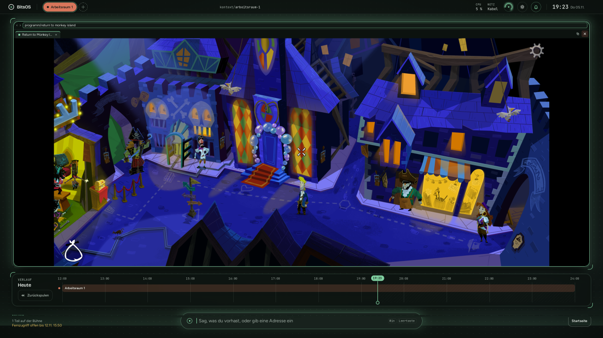
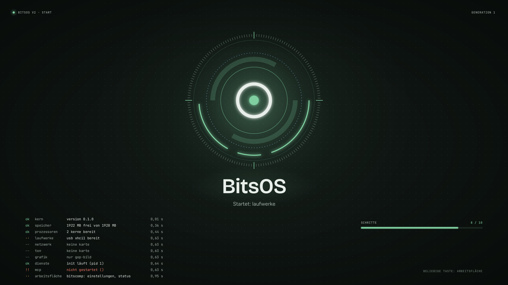

# BitsOS

We have no idea what we're doing.<br>
But it boots.<br>
...and plays sounds.<br>
...and connects to the internet.<br>
...and runs Brave.<br>
...and keeps Brave in a sandbox.<br>
...and opens LibreOffice.<br>
...and shuts down when you type poweroff.<br>
...and survives its own kernel panic.<br>
...and draws with its own driver on a real GPU.<br>
...and logs in to Steam.<br>
...and plays Return to Monkey Island.<br>
...and plays Windows games through Proton.<br>
...and somehow it still boots.

---



BitsOS is a hobby operating system with its own kernel written in Rust. It speaks the Linux system-call
interface, so ordinary Linux programs (BusyBox, a Wayland compositor, the Brave browser, LibreOffice, Steam) run on it
unchanged.

It is built by someone who cannot program, together with AI agents (Anthropic's Claude) that write, review and
test the code. A line only goes into the list above once it is true on the real hardware.

If you want to try it, read [Trying BitsOS](#trying-bitsos) first. If an AI coding agent helps you, point it at
[`AGENTS.md`](AGENTS.md).

## The desktop


These pictures come from the desktop's automated tests in QEMU, so the red and green windows are test programs and
the labels are in German, as on the real machine.

The boot screen lists each start step and hands over to the desktop without a jump. This run had no remote-control
setup, sound or network card, which is why those rows are not green.



| Ring menu on a window | Light theme |
|---|---|
|  |  |

## What is in it

- **Kernel** (`kernel/`, `crates/`): memory management with a page cache and huge pages, a preemptive scheduler
  for all cores, processes and threads, a VFS with FAT32 and ext4, snapshots of the data volume, a kernel journal,
  seccomp, and user, PID, network and mount namespaces.
- **Drivers**, written for BitsOS: NVMe, xHCI USB (keyboards, mice, mass storage, USB audio), Intel I226 Ethernet,
  Realtek RTL8852BE Wi-Fi with WPA2 (ported from Linux's rtw89, see `NOTICE.md`), HD Audio over HDMI/DisplayPort,
  ACPI, and the AMD Radeon 780M: display side (page flips, hardware cursor, display audio) and a GPU driver behind
  Linux's amdgpu interface, so Mesa's RADV and radeonsi run unchanged (see below).
- **Boot loader** (`boot/bitsboot`): a UEFI program with no menu of its own. It sits on the boot volume as
  `\EFI\BOOT\BOOTX64.EFI`, picks a system generation from `\BITSOS2\SYS\` by its markers, gives a new generation one
  try and falls back to the last confirmed one by itself. It never writes UEFI variables.
- **User space** (`user/`): init, `bitscomp` (Wayland compositor and desktop), `settingsd`, `bitsjournal`, `ctxd`
  (a local context index), and ports of BusyBox, Brave, Cobalt, ffmpeg, bubblewrap, Xwayland and Mesa.
- **Remote control** (`crates/mcp`, `host/mcp`): an MCP service, so an AI agent on another machine can read logs,
  inspect hardware and install a new generation. It speaks TLS with a key pairing confirmed at the machine's
  keyboard; full access is limited in time and is only granted from that keyboard.
- **Tests** (`host/xtask`, `host/tests`): over 4,000 unit tests, about 1,100 in-kernel tests and QEMU scenarios
  behind one command, plus check lists run on the real machine.

## State of 11 November 2026 (generation 120)

"On the Mini PC" means tried on the real hardware. "In QEMU" means only tried in the emulator so far.

On the Mini PC, new since 6 November:

- **Programs and games load faster.** The NVMe driver has one queue per CPU (16 on the Mini PC) instead of one
  queue with one command in flight, a read is handed to the drive by the thread that asks for it, ext4 reads
  straight into the page cache's pages, and read-ahead runs in the reader. The first read of a game file after
  boot went from 52 MB/s to 525 MB/s, a large file read in order from 592 to 760 MB/s, 32 readers at once from
  9,000 to 21,600 reads a second. The drive read directly gives 1,700 to 1,900 MB/s (before: 1,349). One number
  got worse: a single random 4 KiB read takes 210 µs instead of 148 µs. The cause is not proven yet.
- **Memory is sorted by mobility**, as Linux does it (page blocks for movable and unmovable use), a background
  thread (`kcompactd`) clears contiguous blocks, and a small reserve (96 MiB here) is kept for kernel requests that
  may not wait.
- **A Steam download beside a video in the browser runs smoothly, with the page cache full.** Getting there took
  one day and ten generations: two kernel panics (a 36 KB and a 17 KB kernel allocation that could not be served
  beside 20 GB of cached files), then a freeze of several seconds, then stutter in sound and picture. The causes
  were kernel code that asked for large blocks of memory at moments when the kernel may not free any: under spin
  locks, in the write-back of dirty pages (16 MiB per run), in the list of files the background writer keeps
  (260,000 entries after Steam had checked a game), and when a large file is cut. A refused kernel allocation now
  records who asked, which is how the last one was found.
- **Dungeon Keeper 2** and **KKND2**, two 32-bit Windows games, run from Steam (see Proton below).
- **A program library on the desktop:** every installed program as a tile, one click starts it; the Windows key,
  a button in the top bar or a gamepad opens it.

From 6 November (generation 107), still true:

- **BitsOS boots from its own EFI system partition on the internal NVMe**, beside Windows partitions on the same
  drive, not only from a USB stick. The CONFIG key `nvme_boot=` names that partition. It is a guarded key: only a
  person editing the file by hand sets it. Writes to `/boot` go only below `\BITSOS2\`, through a second write window
  of exactly that partition, and only beside the data window (`nvme_data=`, see Storage). If any rule is not met,
  `/boot` stays read-only. The USB stick stays as a rescue; while BitsOS runs from the NVMe the stick is read-only.
- **Farthest Frontier**, a Windows game, now starts a new game and plays, through Proton and DXVK on the 780M. Before,
  it quit: processes had an open-file limit of 4096. Programs now get systemd's hard limit of 524288, because
  Proton's ntsync holds one file descriptor per Windows sync object.
- Two kernel panics found while playing are fixed. Each read of `/proc/<pid>/stat` built the numbers of every
  thread (an 85 KB allocation, under memory pressure). And large kernel heap blocks (2 MB) could not be found in
  one piece beside lots of cached memory. Large heap blocks now fall back to single pages mapped together, as
  Linux's `kvmalloc` does. When a contiguous block was missing, `kswapd` now clears one in the background, as Linux's
  `kswapd` does when it is woken with an order.

Known, and planned:

- Used memory pages are not moved yet (page migration), so `kcompactd` can only drop clean cached pages to clear
  a block. Moving pages, modelled on Linux 7.x, is being built.
- One reader gets about 40 % of what the drive gives (760 of about 1,900 MB/s).
- While a file's data is written to the drive, the file system's lock is held. Under a heavy download other
  writers queue behind it for up to 0.6 s. A journal commit behind six parallel writers once took 22 s in a test.

## The first game (5 November 2026)

On the Mini PC, Valve's unmodified Steam client (beta channel, 64-bit) installs and updates itself, logs in, shows its
store and library, and downloads and starts **Return to Monkey Island**, the native 64-bit Linux version. The game draws
on the real Radeon 780M through Mesa, plays its sound over HDMI, runs in its own Steam runtime container and goes
properly fullscreen. Its owner played it for a while and calls it smooth. No frame rate has been measured yet.

*Return to Monkey Island is a game by Terrible Toybox. It is not part of BitsOS and is not in this repository. You
need your own copy.*

What it took, beyond the graphics driver:

- SysV semaphores, shared memory and message queues, per IPC namespace. 19 comparison cases give the same results as
  Linux in QEMU.
- Socket inode numbers in `/proc/net/tcp`, `/proc/<pid>/fd` and `fstat`: Steam's client refused its own interface
  without them.
- A session D-Bus, `/dev/fd`, a library cache that finds the stick's Mesa, and fullscreen for X11 windows through
  `_NET_WM_STATE`.
- A 64-bit stand-in for Steam's 32-bit `reaper`, which starts every game.

### Windows games through Proton (6 November 2026)

On the Mini PC, Steam installs Proton 10.0 and Proton Experimental. Proton runs in WoW64 mode, so Windows programs, 64-bit
and 32-bit, need no 32-bit Linux at all. Windows' `cmd.exe` (both builds) and Notepad run, Notepad in a window on the
desktop. **Farthest Frontier**, a Windows-only 64-bit Unity game, downloads (11.6 GB in about two and a half minutes),
starts from Steam, reaches its main menu in fullscreen, and since 6 November starts a new game and plays. It draws
through DXVK on the 780M's Vulkan driver (RADV), and mouse and quitting work. RADV reports Vulkan 1.4 with every
feature DXVK and vkd3d-proton ask for, sparse resources included.

*Farthest Frontier is a game by Crate Entertainment. It is not part of BitsOS. You need your own copy.*

**Dungeon Keeper 2** and **KKND2**, two 32-bit Windows games, run too. Proton's WoW64 mode runs 32-bit Windows code
inside its 64-bit Wine, so they need no 32-bit Linux either.

*Dungeon Keeper 2 and KKND2 are games by their makers. They are not part of BitsOS. You need your own copies.*

Not there yet:

- No 32-bit Linux programs, so native 32-bit games and parts of Steam that are 32-bit do not run.
- Four games from Steam have been tried: Return to Monkey Island (a Linux game), Farthest Frontier, Dungeon Keeper 2
  and KKND2 (Windows games). Games with anti-cheat have not been tried, and that is deliberate for now.
- The machine has restarted by itself twice, both times under heavy disk traffic: once during a large download and
  once while the Windows game loaded. No crash record survives these restarts. Whether they were the two panics fixed
  on 6 November is not known yet.
- Loading is faster since 11 November (see above) but one reader still gets less than half of what the drive gives.
- X11 windows such as `glxgears` commit only about 30 frames a second. The desktop itself reaches 60.

## Graphics driver (AMD Radeon 780M, state of 5 November 2026)

On the Mini PC:

- Vulkan through Mesa's RADV: a subset of the conformance tests passes, and vkQuake and `vkcube` run. One check in
  the vkQuake round is still red: it counted display writes it cannot explain.
- OpenGL through Mesa's radeonsi: `glxgears` through Xwayland with glamor, the compositor's GLES renderer, and the game.
- The desktop now draws on the GPU by default and shows its frames without a copy. When the GPU is lost after a hang,
  the desktop carries on, drawing on the processor, until the next restart.
- Clock control and a recovery ladder for GPU hangs exist, but their check lists on the real chip are not finished. A
  hung GPU cannot yet be brought back without a restart.
- The BIOS gives the chip 8 GB of the machine's memory.

## Storage

The data volume can live in one partition of an NVMe drive beside another system's partitions. BitsOS writes only
inside that partition's window and refuses everything else. On the Mini PC that gave about 980 GB with 616 MB/s
sequential writes.

Since 6 November BitsOS can also boot from its own EFI system partition on that drive (see the state above). The two windows, data and boot, are the only places on the drive BitsOS may write.

Large downloads and copies run without the kernel running out of memory: the disk driver's bounce buffer and its
write requests stay small, a writer that dirties pages faster than the disk takes them waits its turn, and the
longest wait on the file system's lock fell from 20 s to under 1 s. A 25 GB copy and a 12 GB Steam download went
through on the Mini PC.

## What changed between the first release (26 October 2026) and 3 November 2026

### Graphics driver (AMD Radeon 780M)

At that point the GPU had not drawn a pixel. On the Mini PC, with the running picture untouched at every step (no display
register written):

- The security processor loads 17 firmware images and starts the graphics block; the power firmware mailbox works.
- System memory is mapped for the chip, and the memory-hub registers match what Linux sets.
- The DMA engine runs rings, fills, copies and fences, including through doorbells.
- The graphics ring runs with ring test, indirect buffers and a 64-bit end-of-pipe fence.
- The scheduler firmware (MES) starts, and graphics and compute queues mapped through it pass their tests.
- A GPU address space works: indirect buffers run in it, and intended faults on the graphics and compute rings are
  decoded and survived.
- The chip can be stopped and started again without a reboot, and across a kernel Reload.

In QEMU: `/dev/dri/renderD128` with the Linux amdgpu interface against a fake 780M, and Mesa's RADV and radeonsi running
against that fake up to their first command submission.

### Kernel

- Seccomp with BPF and unprivileged namespaces. On the Mini PC Brave's sandbox page is all green and a crashing tab
  stays contained.
- In QEMU: mount namespaces (bind mounts, propagation, `pivot_root`), with the real bubblewrap 0.13.1 passing its test
  suite with the same results as Linux, and pressure-vessel with Steam's runtime starting a program in its container.
- In QEMU: a vDSO, `process_vm_readv/writev`, `kcmp`, Linux's user segment selectors and a per-process LDT, as
  groundwork for Mesa, Wine and Steam.
- Transparent huge pages for private anonymous memory.
- A lost epoll wake-up that made windows look "not responding" is fixed: 20 minutes of Brave playing video on the Mini
  PC with no lost wake-up.
- An AMD `SYSRET` problem under NMIs and several signal and `iretq` races under backtrace storms are fixed.
- TCP and UDP got Linux-style quick ACKs; node, python and wget fetch at about 117 MB/s, gigabit line rate.

### Desktop

- A new design: dark and light themes, a green accent, new fonts, glass bars, and a real boot screen that the desktop
  takes over without a jump.
- In QEMU: a sound popup with volume per output device, and a close button on workspaces.
- The compositor copies only the damaged parts of the screen: about 30 % less CPU on the screen path on the Mini PC.
- In QEMU: a GLES renderer on software OpenGL and `linux-dmabuf` with explicit sync, ready for the GPU.

### Programs

- LibreOffice Writer opened in a window on the Mini PC, and a document was typed and saved. It now comes from the boot
  stick, with Writer and Calc in the desktop's address bar. Its icons are still invisible in the dark theme.
- In QEMU: Xwayland runs X11 programs on the desktop.

### Reliability

- A forced kernel panic returns to BitsOS by itself in about two minutes.
- A record that survives a reset names the last step before it; 30 reboot and install rounds ran without a CPU
  sync-flood reset.
- `poweroff` and `reboot` work from the shell and ask the desktop to end first.
- A hung machine resets itself through the watchdog, and a bad new kernel falls back to the last good generation.

### Speed (reads of cached files, against CachyOS on the same machine)

- Large reads now match or beat Linux: 1 MiB reads from 8 threads went from 16,800/s to 151,000/s (Linux 129,000/s).
- Small reads are still behind: 16-byte reads from 8 threads on one file reach 2 M/s against Linux's 11 M/s.

### How it is built

- Zero compiler warnings: nothing ships otherwise. A cleanup round went from over 100 warnings to 0 and removed code
  that only tests reached.
- No test may be skipped: a test that cannot do its work is red. The skips that still exist are being worked off.
- Big third-party programs are tested on the real machine only, not in QEMU.
- After every merge, independent checkers look at the merged whole, not only at each change.

## Hardware

BitsOS is developed and tested on one machine: a mini PC with an AMD Ryzen 7 8845HS, Radeon 780M graphics,
an Intel I226 network card and a Realtek RTL8852BE Wi-Fi card. It boots from its own partition on the internal NVMe,
with a USB stick as the rescue. Other hardware will mostly not work yet (see
[On real hardware](#3-on-real-hardware)). QEMU (q35) is used for the automated tests.

## Trying BitsOS

BitsOS is an experiment. It is not secure and not stable. On a real machine, use one whose disks hold nothing you
would miss, and back them up anyway. The easiest way to look at it is the installer's QEMU mode (next section): one
command, and BitsOS runs in a window without touching any disk. The same installer makes a stick for a real machine
from a release without building anything (the section after it).

What BitsOS does to disks, by design:

- It writes only below `\BITSOS2\` on its own boot volume, and only when that volume proves it is the boot volume
  (its `\BITSOS2\STICK.ID` equals the one the loader read, its label is `BITSOS`, and the other rules in section 8).
- Every other disk is read-only: internal NVMe drives, other USB disks, everything. It has no SATA driver at all.
- It never writes a partition table, a boot sector or a UEFI variable.
- The only way to open part of an internal drive for writing is the guarded CONFIG keys of section 6. BitsOS itself
  never sets them: you set them by hand, on another computer, in the stick's `CONFIG.TXT`.

Building it yourself needs an Arch Linux or CachyOS host. Every command below comes from this repository's code
(`host/xtask`, `host/mcp`, `host/installer`). The path from a fresh clone on another person's machine has not been
tried yet: expect to adapt a path or install a package we did not list, and please tell us what you had to change.

### The easiest way: BitsOS in a window, one command, nothing to build

Download the installer of the release you want from `https://github.com/georgwinter89-cloud/BitsOS/releases` (the
files of release `<V>` lie below `releases/download/v<V>/`): `bitsos-install-<V>-linux-x86_64` or
`bitsos-install-<V>-windows-x86_64.exe`. Run it with `--qemu`, without `sudo` and without administrator rights:

```sh
chmod +x bitsos-install-<V>-linux-x86_64
./bitsos-install-<V>-linux-x86_64 --qemu          # asks: remote control, start now
.\bitsos-install-<V>-windows-x86_64.exe --qemu    # Windows
```

It sets QEMU up if this computer lacks it, puts BitsOS into an image file, makes a menu entry or shortcut, and
starts BitsOS in a window. It touches no disk and no stick. Afterwards the shortcut is the one click.

- **QEMU itself.** On Linux it looks for `qemu-system-x86_64`, its window (GTK, else SDL) and the UEFI firmware
  (QEMU's firmware descriptors in `/usr/share/qemu/firmware`, else the places Arch, Debian/Ubuntu, Fedora and
  openSUSE use; never Secure Boot builds). If something is missing it names the command for your distribution, read
  from `/etc/os-release`, for example `sudo /usr/bin/pacman -S --needed --noconfirm qemu-desktop edk2-ovmf` or
  `sudo /usr/bin/apt-get update && sudo /usr/bin/apt-get install -y qemu-system-x86 qemu-system-gui ovmf`, and runs
  it only after your yes (with `sudo`, or `pkexec` without a terminal). On Windows it looks in the folder QEMU's
  installer wrote to the registry and in `Program Files\qemu`; if there is none it offers QEMU for Windows from
  qemu.weilnetz.de (the build qemu.org links to; one pinned build, checked by size and SHA-512 and kept locked until
  its installer has finished), installs it after your yes (Windows asks for permission) and uses its
  `edk2-x86_64-code.fd`. The release itself is checked before anything is installed.
- **Speed.** With KVM (Linux, `/dev/kvm` usable) or the Windows Hypervisor Platform it is fast; otherwise QEMU emulates
  the processor and the installer says so and how to fix it: the group `kvm` on Linux (`sudo usermod -aG kvm $USER`,
  then log out and in); on Windows `optionalfeatures.exe`, "Windows-Hypervisor-Plattform" (Windows Hypervisor
  Platform), then a restart. The start script checks again each time it starts, so after the fix just start BitsOS
  again; the installer need not run again.
- **The image** is `bitsos.img` in `~/.local/share/bitsos/` (`$XDG_DATA_HOME/bitsos`) or `%LOCALAPPDATA%\BitsOS\`
  (`--image-dir` picks another folder), a sparse file of 16 GB (`--size`) that takes only what is written (on Windows
  too: the installer marks it sparse) and is readable by you alone. It is laid out like a stick (MBR, FAT32
  `BITSOS`, `STICK.ID`, `CONFIG.TXT` with `desktop=on` and `screen=1600x900`, `--screen` picks another) from the same
  release files and checks. The program trees are made for the real machine and are untested in QEMU: none by
  default; the questions (or `--trees`, `--steam`, `--brave`) add them. On Windows the installer checks the free
  space before it downloads anything; a disk that fills up later is named as such.
- **Running it again** adds the new release to the image as a new generation; `CONFIG.TXT` and `data.img` stay.
- **Starting it:** `start-bitsos.sh` (Linux) or `start-bitsos.cmd` (Windows) next to the image holds the QEMU
  command, a menu entry (`~/.local/share/applications/bitsos.desktop`, a copy on the desktop) or shortcuts on the
  Desktop and in the Start menu start it, and the installer starts it once at the end if you want. The window is
  QEMU's (q35, UEFI, 4 GB of memory or less on a small computer, up to 4 processors), the image a USB stick on an
  xHCI controller with a USB keyboard and tablet, the network QEMU's. The serial console goes to
  `bitsos-serial.log` beside the image (`BITSOS_SERIAL_LOG=<file>` puts it elsewhere; `BITSOS_QEMU_DISPLAY=none`
  starts without a window). On Windows QEMU's own messages go to `qemu-output.log` there, and if QEMU fails to start
  that file opens in Notepad. The keyboard layout is German.
- **Remote control** yes makes a token (`token.txt` beside the image) and forwards `127.0.0.1:18765` (or the next
  free port) to BitsOS's MCP service; pair with `node host/mcp/pair.mjs 127.0.0.1:18765 --expect <hex>
  --token-file <that token.txt>` and answer in the BitsOS window.
- **Without questions** (for AI agents): `--qemu --remote yes|no --start yes|no`, plus `--install-qemu` to install a
  missing QEMU without asking; without it such a run stops and names the command. `--dry-run` shows what would be
  done and the QEMU command. `--qemu --uninstall` lists the files it made (the image, its firmware variables, the
  scripts, the token, the shortcuts that still start this image) and removes them after a yes (`--yes`; with
  `--dry-run` it only lists); downloads stay in the cache. `--qemu --help` lists every option.
- Tried on CachyOS with KVM (install, a second run adding generation 2, the start script to the desktop). The
  Windows side has been built, and its dry run and its start script (against a stand-in for QEMU, also in a folder
  with umlauts) tried under Wine only; QEMU under Windows has not been run.

### The installer: BitsOS on real hardware without building anything

The way onto a real machine is a USB stick made by `bitsos-install`. The big program trees are made from packages
of the developer's Arch machine that most computers do not have; a release carries them, and the installer does the
whole stick for you.
Its QEMU mode (previous section), QEMU (section 1) and building everything yourself (sections 2 and 4) remain the
other ways.

**Download** from the release of the version you want, `https://github.com/georgwinter89-cloud/BitsOS/releases`
(the files of release `<V>` lie below `releases/download/v<V>/`): `bitsos-install-<V>-linux-x86_64` (a static program
for any x86-64 Linux) or `bitsos-install-<V>-windows-x86_64.exe`. That is all you need; the installer fetches the rest
of release `<V>` itself, and only that release: its version and the SHA-256 of the release's `manifest.json` are
built into it. Downloads go through `curl` (Windows 10 and 11 have it; a Linux without it: `sudo apt install curl`
on Debian or Ubuntu).
The stick needs at least 8 GB, 16 GB with Steam and Brave.

On Linux (a whole disk is written, so it runs as root):

```sh
chmod +x bitsos-install-<V>-linux-x86_64
./bitsos-install-<V>-linux-x86_64 --list        # the sticks it would offer; needs no root
sudo ./bitsos-install-<V>-linux-x86_64          # shows the sticks and asks everything
```

On Windows, right-click Windows Terminal (or the Command Prompt), choose "Run as administrator", and start
`.\bitsos-install-<V>-windows-x86_64.exe` there. `--list` works without administrator rights. This path has been
built and tried under Wine only, not yet on a real Windows machine.

- **Which disks it offers:** only removable USB mass-storage disks with a medium in them, each with its id, size,
  vendor, model and serial. Internal NVMe and SATA drives and the laptop's own card slot are not listed at all. USB
  disks that hold the running system (`/`, `/boot`, swap, LVM or LUKS; on Windows the Windows folder, the partition
  Windows started from or a page file), USB disks that call themselves fixed disks (many USB SSDs and a few fast
  sticks), sticks with sectors other than 512 bytes and empty card readers are listed as `not offered`, with the
  reason. On Linux a mounted stick has to be unmounted first (in the file manager, without unplugging it). On Windows
  the installer locks and dismounts the stick's own drive letters itself, and asks you to close Explorer windows on
  it if Windows will not let go.
- **The id:** a stick's id is its system name, its size and four hex digits made from its vendor, model and serial,
  for example `sdb-31.0G-3fa2` on Linux or `disk2-31.0G-3fa2` on Windows. Another stick that later gets the same
  name and size has another id, so an id names one stick only.
- **Its question before it writes:** you type `ERASE <id>` exactly as listed (`UPDATE <id>` for a stick that
  already holds BitsOS, see below).
- **What it asks:** Wi-Fi name and passphrase (typed without echo) or cable only; remote control for an AI helper
  yes or no; the screen mode (Enter: 2560x1440 if the screen offers it, else the firmware's mode; `largest` for the
  biggest mode); whether to add Steam and Brave.
- **Remote control:** yes makes a random token and writes `token=` and `mcp=service`, the TLS service you pair at
  the machine's keyboard. The token is kept on this computer in `~/.config/bitsos/sticks/<stick id>/token.txt`
  (mode 0600; under `sudo` in your own home, not root's) or `%APPDATA%\BitsOS\sticks\<stick id>\` on Windows (with an
  access list naming only you). It is saved before the stick is written; if that fails, nothing is written. An
  interactive run shows the token once; a run with every answer as a flag does not print it. Pairing uses
  `host/mcp/pair.mjs` from this repository and Node.js (section 9).
- **What it downloads:** the release assets of its own version. Each is checked against `manifest.json`, and the
  manifest against the SHA-256 built into the installer, so a changed file is refused before anything is written.
  Downloads are kept in `bitsos-install/<V>/` below the cache folder (`~/.cache`, `%LOCALAPPDATA%` on Windows,
  `--cache DIR` picks another); an interrupted one resumes on the next run. Before any download it checks that the stick is big enough for what you chose.
- **Steam and Brave** are not passed on by us: the installer fetches Valve's and Brave's files from them on your
  computer, checks each against the file BitsOS was tested with (SHA-256), and adds the open-source rest from the
  release. Valve publishes only its newest Steam client, so once Valve moves on, the pinned Steam cannot be fetched.
  If a program you asked for cannot be fetched or does not match, the installer says `NOT INSTALLED: <program>:
  <why>` and asks whether to go on without it; with every answer as a flag it stops before writing, unless
  `--allow-missing` is given.
- **What the stick gets:** an MBR with one FAT32 partition of type `0Ch` labelled `BITSOS` (a GPT "Microsoft basic
  data" or EFI system partition would keep BitsOS read-only, see section 4), a fresh random `\BITSOS2\STICK.ID` (also
  kept beside the token), bitsboot as `\EFI\BOOT\BOOTX64.EFI`, generation 1 in `\BITSOS2\SYS\1\`, the firmware,
  `\BITSOS2\bin\`, the trees and a `CONFIG.TXT` with your answers. It never writes `nvme_write`, `nvme_data`,
  `nvme_boot`, `stick_write`, `usb_msd_write` or `mcp_confirmer`. Everything written is read back from the stick and
  compared. If something fails after the stick was erased, the installer says so; run it again, it starts over.
- **A stick that already holds BitsOS** (label `BITSOS` and a `\BITSOS2\STICK.ID`) can be updated instead of erased:
  the release becomes a new generation (as `cargo xtask stick` does it), and `CONFIG.TXT`, `data.img`, `home\`,
  `mcp\` and the older generations stay. bitsboot gives the new generation one try and falls back to the old one if
  it does not come up.
- **Without network:** `--assets DIR` installs from release files you downloaded by hand into `DIR` (with
  `manifest.json`); `--vendor-cache DIR` points at Steam's or Brave's downloads; `--offline` downloads nothing.
- **For AI agents:** `--list` shows the sticks; `--erase <id>` (or `--update <id>`) with every answer as a flag
  runs without questions:

  ```sh
  sudo ./bitsos-install-<V>-linux-x86_64 --erase <id> --cable-only --remote no --steam no --brave yes
  sudo ./bitsos-install-<V>-linux-x86_64 --erase <id> --wifi <name> --wifi-psk-file <file> --remote yes \
      --steam yes --brave yes
  sudo ./bitsos-install-<V>-linux-x86_64 --update <id> --steam no --brave no
  ```

  The passphrase is read from the first line of `--wifi-psk-file`; secrets never go on the command line. The agent
  shows the person the list and uses the id the person confirms, never one it picked itself (AGENTS.md, rule 3). A
  stick without a serial number cannot be named that way and is chosen in an interactive run. `--help` lists every
  option.

**Afterwards:** turn Secure Boot off in the firmware settings (bitsboot is not signed), plug the stick in, open the
firmware's boot menu (often F7, F8, F11, F12 or Esc) and choose the stick's UEFI entry. The keyboard layout is German
(QWERTZ): on a US keyboard `y` and `z` are swapped. HDMI sound can be loud; turn the volume down before the first
start. Section 3 says what hardware works; section 8 what to check when nothing starts.

**Making a release** (the developer's step): `cargo xtask release-assets --version <V>` builds the lean release image
and packs the assets into `target/release-assets/` (`--help` says what goes into them). It needs the program stages
and the musl sysroot (section 2), reads every archive back with the installer's own reader, and builds
`bitsos-install` with that release's manifest hash. Every file there is uploaded to the GitHub release `v<V>`.

### 1. In QEMU

You need an x86-64 Linux machine, about 10 GB of free disk space for a first build (the Rust toolchains add about
4.5 GB in `~/.rustup`), and KVM for a usable speed. Without `/dev/kvm`, xtask falls back to QEMU's slow emulation.

Packages on Arch Linux or CachyOS:

```sh
sudo pacman -S --needed git rustup clang binutils qemu-system-x86 edk2-ovmf mtools dosfstools zstd nodejs \
    linux-firmware-amdgpu linux-firmware-realtek foot alsa-utils noto-fonts adwaita-cursors liblangtag ninja udisks2
```

The image also copies files that a normal desktop install already has (`bash`, `glibc`'s locales, `fontconfig`,
`xkeyboard-config`, `tzdata`, `libx11`'s compose files, the CA certificates).

On Debian or Ubuntu (untested): `qemu-system-x86 ovmf mtools dosfstools zstd clang binutils nodejs`, plus `rustup`
from rustup.rs. xtask looks for the UEFI firmware at Arch's paths, `/usr/share/edk2/x64/OVMF_CODE.4m.fd` and
`/usr/share/edk2/x64/OVMF_VARS.4m.fd`; Debian ships them as `/usr/share/OVMF/OVMF_CODE_4M.fd` and
`/usr/share/OVMF/OVMF_VARS_4M.fd`, so link them there. The GPU and Wi-Fi firmware is read from Arch's packages
(`/usr/lib/firmware/<name>.zst` and their licence files); without them the image is made without firmware, which only
matters on real hardware.

Get the code and the toolchains (the kernel uses a pinned nightly from `rust-toolchain.toml`, the user programs the
stable toolchain from `user/rust-toolchain.toml`):

```sh
git clone <this repository's URL> BitsOS
cd BitsOS
rustup toolchain install          # the nightly with rust-src, llvm-tools and the three targets
(cd user && rustup toolchain install)
```

Build an image and boot it:

```sh
V2_PKG_OPTIONAL=1 cargo xtask image --name try --config-extra "desktop=on"
cargo xtask qemu --name try --display gtk --timeout 3600 --mem 4G --smp 4 --res 1920x1080 --net user \
    -- -device usb-kbd,bus=xhci.0 -device usb-tablet,bus=xhci.0
```

- `V2_PKG_OPTIONAL=1` is needed on your machine. The package list (`user/packaging/manifest.txt`) also names the big
  program trees and a few files that exist only on the developer's machine; without this variable the build stops at
  the first one it cannot find. With it, each missing part is a `note:` line and the image is made without it.
- `--config-extra "desktop=on"` starts the desktop. By default (`desktop=auto`) the desktop starts on real hardware
  and QEMU shows the text console.
- The image is `target/xtask/try.img`, a FAT32 file system labelled `BITSOS`, with its files also in
  `target/xtask/esp-try/`. xtask never writes a real disk for QEMU: it refuses host disks, passthrough and ports
  outside its own range, and boots the image as a USB stick.
- The USB keyboard and tablet after `--` are needed: BitsOS has no PS/2 keyboard driver.
- `cargo xtask qemu` options: `--name N` (default `test`), `--smp N` (default 2), `--mem M` (default `2G`),
  `--net none|user|igb|virtio` (default `none`; `user` and `virtio` give a virtio network card, `igb` an Intel 82576
  that uses the same driver as the I226), `--hostfwd HOST:GUEST` (needs a network; host ports 20000 to 20499),
  `--res WxH`, `--display none|gtk` (default `none`), `--timeout S` (default 60), `--serial-log F`. If the image
  does not exist yet, `cargo xtask qemu` builds it with default settings first.

The first build takes a while: the kernel, the boot loader, the user programs and the desktop are compiled from
source. Expect roughly 10 to 30 minutes on a common 8-core machine; later builds take a minute or two.

What you should see: the firmware, then the boot screen with its list of start steps, then the desktop drawn by the
processor (QEMU has no GPU for BitsOS). The terminal where you started xtask shows the serial log as it is written,
starting with `bitsboot:` lines. The log is also kept in `target/xtask/try.log`.

The labels are German, and so is the keyboard layout: BitsOS has a German (QWERTZ) layout only. On a US keyboard
`y` and `z` are swapped, `/` is Shift+7 and `-` sits on the US `/` key.

To quit, type `poweroff` at a console prompt, or close the QEMU window. xtask stops QEMU by itself after `--timeout`
seconds and then says `timeout: QEMU was stopped by xtask`. QEMU runs with `-no-reboot`, so `reboot` ends it too.

In QEMU there is no sound, no Wi-Fi and no GPU driver. The big programs (Brave, LibreOffice, Steam) are tested on
the real machine only and are not in a QEMU image.

### 2. The full image with the big programs

Brave, LibreOffice, Mesa (RADV and radeonsi), Xwayland, Steam, vkQuake and Cobalt (YouTube TV) are not in this
repository. Each becomes a **stick tree**: a folder `\BITSOS2\<name>\` on the boot volume (`/boot/BITSOS2/<name>`
when BitsOS runs), made from the build machine's own installed packages or from pinned downloads, with the libraries
its programs need. A script in `user/ports/` makes each one in `/var/tmp/claude-v2/stage/<name>`, the place the
package list reads it from:

| Tree | Script | Needs |
|---|---|---|
| `mesa`, `deqp` | `user/ports/mesa/scripts/stage-stick.sh` | Arch's Mesa and Vulkan packages (checked against pacman's signatures); `deqp` builds the Vulkan conformance runner (about ten minutes) |
| `xwayland` | `user/ports/xwayland/scripts/build-v2.sh` | the Mesa stage; X.Org source tarballs from the download cache |
| `brave` | `user/ports/brave-launcher/scripts/stage-v2.sh` | Brave installed as `brave-bin` (`/opt/brave-bin`) |
| `libreoffice` | `user/ports/libreoffice-launcher/scripts/stage-v2.sh` | `libreoffice-fresh` installed, its package file still in pacman's cache |
| `steam` | `user/ports/steam/scripts/stage-v2.sh` | Valve's files, downloaded and checked against `user/ports/steam/pins.txt`; the graphics provider from `user/ports/steamrt` |
| `vkquake` | `user/ports/vkquake/scripts/stage-v2.sh` | the Mesa stage; vkQuake and SDL2 release tarballs; LibreQuake's free game data |
| `cobalt` | `user/ports/cobalt-launcher/scripts/stage-v2.sh` | a Cobalt build made beforehand |

Read each script's header before you run it. Downloads are kept in `$V2_DOWNLOADS` (default
`~/.cache/bitsos-v2/downloads/`) and checked against the SHA-256 the script names; `user/ports/README.md` lists them.

Then name the trees you want, or `1` for all:

```sh
V2_PKG_OPTIONAL=1 V2_LEAN=1 V2_STICK_TREES=mesa,xwayland,brave,libreoffice,steam \
    cargo xtask image --name full --release
```

`V2_LEAN=1` leaves the test programs out, `--release` builds an optimised kernel. Without `V2_STICK_TREES` no image
carries a tree. With all trees the image is about 3 GB, and its folder `target/xtask/esp-full/` as much again.

**The musl sysroot.** BusyBox (the console shell and the small Unix tools), bubblewrap (`/bin/bwrap`, which Steam's
container needs) and the ABI test programs are built against musl 1.2.6 and LLVM's libc++ in `user/sysroot/`.
`user/sysroot/build.sh` builds it from read-only source trees that you give it as `V2_MUSL_SRC` (a musl 1.2.6 source
tree) and `V2_LLVM_SRC` (an llvm-project checkout with `libcxx`, `libcxxabi`, `libunwind` and
`compiler-rt/lib/builtins`); its defaults are paths on the developer's machine. BusyBox also needs its tarball in the
download cache, because xtask builds the ports offline. Without the sysroot the image has no BusyBox and no
`bwrap`: the kernel, the desktop, the `foot` terminal and the Rust programs still work, the text console falls back to
the kernel's own monitor prompt, and Steam's container cannot start.

### 3. On real hardware

Known to work: one machine, a mini PC with an AMD Ryzen 7 8845HS, Radeon 780M graphics, an Intel I226 network card
and a Realtek RTL8852BE Wi-Fi card.

On any other machine, expect this:

- **UEFI on x86-64 only**, with a processor of at least the x86-64-v3 level (AVX2, BMI1/2, MOVBE; roughly Intel
  Haswell or AMD Zen and newer). bitsboot names what is missing and stops on an older one.
- **Secure Boot must be off.** bitsboot is not signed.
- **Intel processors start in safe mode.** On an Intel CPU without a hypervisor, bitsboot uses the safe profile: no
  network driver, no Wi-Fi, the stick and every disk read-only, the firmware's picture, and the newest confirmed
  generation instead of a new one's try. `profile=normal` in `CONFIG.TXT` turns that off. AMD machines get the
  normal profile.
- **Graphics:** the GPU driver knows the Radeon 780M only. Everywhere else the desktop draws on the processor into the
  framebuffer the firmware set up.
- **Network:** Intel I226 (and the 82576 that QEMU emulates), the Realtek RTL8852BE Wi-Fi card, and virtio-net in
  QEMU. No other wired or wireless card has a driver.
- **Input:** USB keyboards and mice only. A laptop's built-in keyboard and touchpad will most likely not work.
- **Storage:** NVMe and USB mass storage, read-only unless the rules below allow a write. No SATA.
- **Sound:** HD Audio over HDMI/DisplayPort and USB audio. HDMI sound can be loud: turn the volume down first.

Nothing on an internal disk is written unless you set the guarded keys by hand (section 6).

### 4. Writing a USB stick

This is the way for an image you built yourself; from a release, the installer above does all of it.
`cargo xtask stick` writes BitsOS onto a USB stick through its mounted FAT32 file system. It never formats, never
touches a raw device and never changes a partition table, so preparing the stick is your step.

1. **Prepare the stick** (this erases it). Use one of at least 8 GB, 16 GB or more with the big programs: BitsOS
   makes a data image `\BITSOS2\data.img` of 2 GB on it at the first start when 512 MiB stay free beside it. The stick
   needs an MBR partition table with one FAT32 partition (type `0Ch`) labelled `BITSOS`. Do not use a GPT partition
   of type "Microsoft basic data" (what many tools choose for FAT32) or an EFI system partition: BitsOS then keeps
   the stick read-only. For example, after `lsblk` has shown you which device is the stick (here `/dev/sdX`):

   ```sh
   sudo parted /dev/sdX --script mklabel msdos mkpart primary fat32 1MiB 100%
   sudo mkfs.fat -F 32 -n BITSOS /dev/sdX1
   udisksctl mount -b /dev/sdX1          # mounts it at /run/media/$USER/BITSOS
   ```

2. **Give the stick an ID.** The tool writes only a stick whose `\BITSOS2\STICK.ID` holds the 32 hex digits that
   `stick.id` in the repository holds:

   ```sh
   openssl rand -hex 16 > stick.id
   mkdir /run/media/$USER/BITSOS/BITSOS2
   cp stick.id /run/media/$USER/BITSOS/BITSOS2/STICK.ID
   ```

   Keep `stick.id` out of commits. BitsOS never writes `STICK.ID` itself; it uses it to tell its own stick from every
   other disk.

3. **Write a `CONFIG.TXT`** in a file of your own, for example `~/bitsos-config.txt` (keys in section 5). A good start:

   ```
   loglevel=info
   panic=reboot
   ```

4. **Build an image** as in section 2, for example `V2_PKG_OPTIONAL=1 V2_LEAN=1 cargo xtask image --name mystick --release`.

5. **Look before you write.** Without `--write` the tool only shows the stick, its generations and the plan:

   ```sh
   cargo xtask stick --target /run/media/$USER/BITSOS \
       --kernel target/xtask/esp-mystick/BITSOS2/SYS/1/KERNEL \
       --initrd target/xtask/esp-mystick/BITSOS2/SYS/1/INITRD \
       --bitsboot target/xtask/esp-mystick/EFI/BOOT/BOOTX64.EFI \
       --config ~/bitsos-config.txt
   ```

   Check the first line (`stick: <mount point> = <device> (usb <model>), label BITSOS, FAT32, ...`). Then run the same
   command with `--write`; it shows the plan again and writes only after you type `J` and Enter. It checks the stick
   once more after your answer. (`--build --release` instead of the three file options builds kernel, initramfs and
   bitsboot itself, but brings no firmware and no programs from the stick folder.)

6. **Copy the rest by hand** from the image folder: the firmware, the stick programs and the trees you built.

   ```sh
   cp -r target/xtask/esp-mystick/BITSOS2/firmware target/xtask/esp-mystick/BITSOS2/bin /run/media/$USER/BITSOS/BITSOS2/
   cp -r target/xtask/esp-full/BITSOS2/brave /run/media/$USER/BITSOS/BITSOS2/      # each tree you want
   ```

   Never copy the image folder's `SYS`, `STICK.ID` or `CONFIG.TXT`: its `STICK.ID` is a fixed test ID.

7. **Unmount** before you pull the stick: `udisksctl unmount -b /dev/sdX1` (the tool prints this line).

The tool refuses, and writes nothing, when: the target is not a mount point or is one of the running system's
(`/`, `/boot`, `/home`, ...); the file system is not FAT32 (vfat) or not labelled `BITSOS`; the device is not on
USB (`--force` accepts another removable bus, never a built-in NVMe, SATA or virtio disk); the stick sits on the same
disk as the running system or on more than one disk; it has a `Windows` folder; it has no `STICK.ID` or another one
than `stick.id`; `\EFI\BOOT\BOOTX64.EFI` belongs to another system; it is mounted read-only; the plan does not fit;
the `--config` file sets `nvme_write`, `stick_write` or `usb_msd_write`; the stick changed while the question waited;
or the kernel and initramfs equal the newest generation's. It writes only below `\BITSOS2\` and `\EFI\BOOT\`.
`--config` is used only on a stick that has no `CONFIG.TXT` yet; later you edit that file by hand.

Afterwards the stick holds `\EFI\BOOT\BOOTX64.EFI` (bitsboot), `\BITSOS2\STICK.ID`, `\BITSOS2\CONFIG.TXT` and
`\BITSOS2\SYS\1\` with `KERNEL`, `INITRD` and the marker `NEW`, plus what you copied. BitsOS adds `data.img`, `home\`
and, with the remote-control service, `mcp\`.

**Booting it.** Turn Secure Boot off in the firmware settings. Plug the stick in, switch on, and open the firmware's
boot menu (the key depends on the maker; often F7, F8, F11, F12 or Esc). Choose the USB stick's UEFI entry. If
bitsboot cannot start a system, it shows why and returns to the firmware after a key press or a few seconds.

**Generations.** Each write of a kernel is a generation, `\BITSOS2\SYS\<n>\`. A new one (`NEW`) gets one try: bitsboot
writes `TRY` next to it and starts it. It becomes confirmed (`OK`) when the remote-control service has answered
requests for `boot_confirm_s` seconds (default 120); otherwise the next start goes back to the newest confirmed
generation by itself. Without remote control, confirm a generation that worked yourself:
`cargo xtask stick --target /run/media/$USER/BITSOS --confirm 1 --write`. While no generation is confirmed, the
newest one keeps starting, and the next bundle you write takes its place. To start an older confirmed generation,
write its number into `\BITSOS2\SYS\PIN` by hand; `--unpin` removes the pin. `--prune` keeps the newest `sys_keep`
confirmed generations (default 5). `cargo xtask stick --help` lists every option.

### 5. CONFIG.TXT

`\BITSOS2\CONFIG.TXT` holds `name=value` lines. `#` starts a comment, spaces around names and values do not count,
and the last line of a name wins. To change it, mount the stick on another computer and edit the file; most keys take
effect at the next start.

| Key | Meaning | Default |
|---|---|---|
| `loglevel` | kernel log detail: `error`, `warn`, `info`, `debug`, `trace`, or per subsystem (`warn,net=debug`) | `info` |
| `console_log` | what the text console shows: `off`, `error`, `warn`, `info`, `debug`, `all` | `warn` |
| `desktop` | `auto` (on real hardware, off in QEMU), `on`, `off` | `auto` |
| `panic` | after a kernel panic: `halt` (keep the report on screen) or `reboot` | reboot after `panic_delay` on hardware, halt in QEMU; `cargo xtask image` writes `panic=halt` |
| `panic_delay` | seconds before the reboot after a panic | `30` |
| `profile` | `normal`, `gaming-pc` (the safe mode), `auto` | by machine: safe mode on Intel without a hypervisor |
| `gpu` | `on` brings the Radeon 780M up at boot, `off` keeps it down | `on` |
| `bitscomp` | desktop renderer: `auto`, `gpu`, `gles`, `rescue` (processor only) | `auto` |
| `smp`, `cpus` | `smp=off` uses one CPU; `cpus=N` at most N | all CPUs |
| `wlan` | `on` lets the Wi-Fi driver touch the RTL8852BE at all | off |
| `wlan_ssid` | the network's name | none (nothing is joined) |
| `wlan_psk` | WPA2 passphrase (8 to 63 characters) or the key as 64 hex digits; a secret | none |
| `wlan_channels` | channels to scan, one band, e.g. `1,6,11` or `36,40,44` | 2.4 GHz channels 1 to 13 |
| `mirror` | `a.b.c.d[:port]`: send every log line by UDP to that machine | off; port 6666 |
| `data_img_mb` | size of a new `\BITSOS2\data.img` (`/data`) in MiB, 32 to 4095, `0` for none | `2048` |
| `token` | the remote-control token, 8 to 127 printable characters without spaces; a secret. Without it remote control does not start | none |
| `mcp_port` | the remote-control port | `8765` |
| `boot_confirm_s` | seconds of remote-control answers that confirm a new generation (10 to 86400) | `120` |
| `sys_keep` | confirmed generations kept on the stick | `5` |
| `mcp` | guarded. `kernel`: the kernel's plain-HTTP server, the token alone opens everything; `service`: the TLS service with pairing at the keyboard; `both`: both, the service on `mcp_port`+1 | `kernel` |
| `mcp_confirmer` | guarded. `bitscomp` (a person at the desktop answers the installer's questions) or `test` (a test program answers them; QEMU scenarios only) | `bitscomp` |
| `nvme_write` | guarded. `on` allows NVMe writes at all, still only through a window (section 6) | off |
| `nvme_data` | guarded. The data window: `<serial>:<partition GUID>:<first LBA>:<blocks>` | none |
| `nvme_boot` | guarded. BitsOS's own EFI system partition on the same drive, in the same form | none |
| `stick_write`, `usb_msd_write` | guarded test switches: raw writes to the boot stick, writes to other USB disks. Leave them off | off |

**Guarded keys** (`nvme_write`, `nvme_data`, `nvme_boot`, `stick_write`, `usb_msd_write`, `mcp`, `mcp_confirmer`):
BitsOS never adds or changes these lines. Its file system refuses any write to `CONFIG.TXT` that would add or change
one, whoever writes it: a program, the settings service or the remote control. Removing a guarded line is allowed,
except `mcp`. `cargo xtask stick --config` refuses a file that sets `nvme_write`, `stick_write` or `usb_msd_write`.
The one exception is `bitsdisk` (section 6), which writes the `nvme_data=` line after you typed a code at the real
keyboard. Everything else is your edit, by hand, on another computer.

**Secrets** (`token`, `wlan_psk`, `claude_api_key`) are plain text in the file on the stick: anyone who has the
stick can read them. Inside BitsOS they are never logged and never shown: the remote control's file tools show them as
`***`, and a `CONFIG.TXT` written back from such a read keeps the stick's values. The kernel blanks their values with
spaces in its copy of the boot data right after reading them, turns `wlan_psk` into the WPA key at once and wipes the
passphrase, and drops `claude_api_key`, which nothing reads. Remove these lines before you show anyone your
`CONFIG.TXT`.

### 6. Optional: data and booting on an NVMe drive

**Back up the whole drive first.** These steps open one partition of an internal drive for writing. The rules below
are checked at every start and before every write, but this is a hobby kernel.

**Data on an NVMe partition** (`/data` larger than the stick's 4 GB image, for Steam games):

1. Make an empty partition yourself, for example in Windows' disk management or with a Linux tool. It must be a GPT
   partition of type "Microsoft basic data" (what Windows gives a new partition) or "Linux data". Do not format it.
2. On the stick, add `nvme_write=on` to `CONFIG.TXT` by hand.
3. Start BitsOS and run `bitsdisk` at the text console, as root, on the machine's real keyboard (`bitsdisk list`
   only shows). It lists the drives and partitions and what each may become, asks for a number, and asks you to type
   the last six characters of the drive's serial number. Keys sent by the remote control or by a program do not
   count. It then writes the `nvme_data=` line, makes BitsOS's pool and an ext4 file system inside the partition, and
   the next start puts `/data` there.

At every start the window opens only if all of this holds: `nvme_write=on`; the drive's serial number, the
partition's unique GUID, its first block and its size equal the `nvme_data=` line (a moved or resized partition is
refused); primary and backup GPT agree; the partition lies inside the table's usable blocks and overlaps no other
entry; its type is one of the two above; it holds no file system other than BitsOS's own pool; and the drive holds no
EFI system partition except the one `nvme_boot=` names. If anything fails, the whole drive stays read-only and `/data`
stays on the stick. `cat /proc/bitsos/data-window` shows what this start decided.

**Booting from the NVMe** (`nvme_boot=`): BitsOS can start from an EFI system partition on the same drive as the data
window. You make that partition yourself, label its FAT32 file system `BITSOS`, copy the stick's `\EFI\BOOT\BOOTX64.EFI`
and `\BITSOS2\` onto it (with the same `STICK.ID`), and add it to the firmware's boot order yourself: BitsOS writes no
boot entries. Add `nvme_boot=<serial>:<GUID>:<first LBA>:<blocks>` to `CONFIG.TXT` by hand. When the drive holds an
EFI system partition that no key names, the refusal in the log ends with the `nvme_boot=` line that would name it;
copy it only if that partition really is BitsOS's own.

`/boot` on the NVMe takes writes only when: its `STICK.ID` equals the one bitsboot read; its label is `BITSOS`; it has
two FATs; exactly one disk matches the boot volume; `nvme_write=on`, `nvme_data=` and `nvme_boot=` name the same
drive; the data window is armed; the boot volume is exactly the partition `nvme_boot=` names; and the table still
passes the window check. The writes then go through a second window of exactly that partition, only below `\BITSOS2\`.
Any doubt leaves `/boot` read-only. A USB stick plugged in beside it is an ordinary, read-only disk.

BitsOS refuses, always: any write to a partition table or boot sector; any write to a Windows partition or outside
the windows; the whole drive; a drive with a second EFI system partition, or one in a hybrid MBR.

### 7. First steps after boot

- **The desktop** starts after the boot screen. Press any key during the boot screen to see the text console instead.
  Keys (German layout): Ctrl+Alt+Enter opens a terminal (`foot`), Ctrl+Alt+L the address bar, Ctrl+Alt+1 to 9 switch
  workspaces, Ctrl+Alt+N makes a new one, Ctrl+Alt+W lists them, Ctrl+Alt+X closes a window, Alt+Tab switches
  windows, Super+Up and Super+Down maximise and minimise, Ctrl+Alt+Q ends the desktop.
- **The address bar** opens `terminal`, `writer`, `calc`, `impress`, `draw` and `libreoffice` (also with `programm/`
  in front) and the settings, `einstellungen`. Web addresses do not open there yet.
- **The terminal and the text console**: the shell's `PATH` includes `/boot/BITSOS2/bin`, where the stick programs
  are. The kernel's monitor prompt knows `help`, `log [n]`, `mem`, `cpus`, `net` (cards and addresses), `reboot` and
  `poweroff`.
- **Brave**: `brave` in a terminal (needs the `brave` tree). `brave --check` says what it found.
- **LibreOffice**: `writer` or `calc` in the address bar, or `libreoffice writer` in a terminal (needs its tree).
- **Steam**: `steam` in a terminal (needs the `steam`, `mesa` and `xwayland` trees and the musl sysroot's `bwrap`).
  It is Valve's beta client, 64-bit only. It unpacks itself to `/data` at the first start, and you log in yourself.
  For Windows games, install Proton from the library's tools. Games need room on `/data`: the stick's image holds at
  most 4 GB.
- **Sound** plays over HDMI or DisplayPort. Start with the volume low; the sound popup on the desktop sets it per
  output.
- **Network**: Ethernet takes an address by DHCP by itself. Wi-Fi needs `wlan=on`, `wlan_ssid=` and `wlan_psk=` in
  `CONFIG.TXT` and the firmware in `\BITSOS2\firmware\`.
- **Switching off**: `poweroff` or `reboot` in a shell, or the desktop's power menu. Both only take real keys: the
  remote control cannot switch the machine off.

### 8. When something breaks

- **A kernel panic** prints a report on the screen: the panic line, a backtrace with function names for each CPU and
  the newest log lines. With `panic=reboot` the machine restarts after `panic_delay` seconds. The same report goes
  into a crash record in memory; when the memory survives the restart, the next start logs it as `crash.previous`
  (the remote control's `crash_info` and `log` show it too). A full power cycle loses it. Take a photo of the screen.
- **The kernel journal**: `bitsjournal` keeps the kernel's events and metrics for weeks in `/data/system/journal/`.
  `bitsjournal query since=<unix seconds> level=warn` prints them. At the text console, `log 100` shows the newest
  100 lines.
- **Getting logs off the machine**: `mirror=192.168.100.10` in `CONFIG.TXT` sends every log line by UDP to port
  6666 of the computer with that address, where any UDP listener can write them down; or write a query to the stick, `bitsjournal query since=<unix seconds> > /boot/BITSOS2/journal.txt`, and read it on another computer;
  or use the remote control (section 9). In QEMU the serial log is `target/xtask/<name>.log`.
- **The stick is read-only**: the kernel log has a line `fat stick.decided ... rw=false ... reason=...` that names
  the first rule that failed. BitsOS writes its boot stick only when bitsboot handed over the stick's `STICK.ID` and
  the volume holds the same one, the label is `BITSOS`, exactly one disk looks like the boot volume (a cloned stick
  plugged in beside it turns writing off), the device is not write-protected, the partition table holds no Windows
  or EFI system partition, and the volume has two FATs. Safe mode (section 3) keeps the stick read-only on purpose.
- **A bad kernel**: a new generation that panics, hangs or never gets confirmed is not started again; the next start
  takes the newest confirmed one. To force one, write its number into `\BITSOS2\SYS\PIN` on the stick.
- **Reporting an issue**: open an issue on GitHub with your hardware (CPU, graphics, network card), the commit you
  built, what you did and what you saw, the log (serial log, mirror, journal or a photo), and your `CONFIG.TXT` with
  `token`, `wlan_psk`, `wlan_ssid` and the `nvme_*` values removed.

### 9. Remote control for AI agents

The kernel can serve the Model Context Protocol (MCP) over the network, so an agent on another computer can read
logs, look at the hardware and the screen, run programs and install a new generation. The tools are in `host/mcp/`
and need Node.js.

**It is off until you set `token=`.** Then, by default (`mcp=kernel`), the kernel serves plain HTTP on port 8765 at
`/mcp`, with the token as a bearer token. **The token alone opens everything**: programs as root, every file, the
screen, keys, installs and reboots, and it crosses the network in plain text. Use that only in QEMU or on a network
you trust completely.

In QEMU, with a throwaway token in a file `token.txt`:

```sh
V2_PKG_OPTIONAL=1 cargo xtask image --name mcp --config-extra "token=$(cat token.txt)"
cargo xtask qemu --name mcp --net user --hostfwd 20001:8765 --timeout 1800
node host/mcp/mcp-call.mjs 127.0.0.1:20001 version --token-file token.txt
node host/mcp/mcp-call.mjs 127.0.0.1:20001 hw_info '{"section":"cpu"}' --token-file token.txt
```

**The safer way is `mcp=service`** (a guarded key, so you add it by hand): the user-space service `bitsmcp` serves
MCP over mutual TLS on `mcp_port`. At every start it prints its key on the console and the mirror:
`bitsmcp: TLS server key sha256 <hex>`.

1. Pair once, from your computer (192.168.100.20 stands for BitsOS's address, which the monitor's `net` shows):

   ```sh
   node host/mcp/pair.mjs 192.168.100.20:8765 --expect <hex from that line> --token-file token.txt
   ```

   The machine shows a dialog naming your computer's key; answer it at the machine's real keyboard within five
   minutes. Your key and the machine's pinned key go into `bitsos-mcp/` next to the token file (or
   `~/.config/bitsos-mcp/`), never into the repository. The service takes a pairing only while no client is paired.
2. Calls then go over TLS: `node host/mcp/mcp-call.mjs 192.168.100.20:8765 version --token-file token.txt --tls auto`.
   A paired client gets a narrow set: `version`, `hw_info`, `log`, `events`, `metrics`, `gpu`, `reload_info`,
   `system_list`, the safe in-kernel tests with `output` and `stop`. `install_kernel`, `install_system`, `reload`,
   `reboot` and `system_pin` each ask at the machine first.
3. Full access (every kernel tool: programs as root, files, screen, keys, installs, reboots) is granted only at the
   real keyboard, for 1 hour, 8 hours, 24 hours or 7 days, optionally with NVMe writes: the agent asks with
   `node host/mcp/access.mjs 192.168.100.20:8765 request --hours 1 --reason "read the journal" --tls auto --token-file token.txt`
   and waits up to five minutes; or you open it yourself with Ctrl+Alt+V, which also ends it.
   `access.mjs ... status` shows the time left.

More tools: `install.mjs` installs a kernel bundle as a new generation (`--bundle target/xtask/esp-<name>/BITSOS2/SYS/1
--bind <your LAN address>`, `--dry-run`, `--reboot` waits for the confirmation); `push.mjs` copies a tree onto the
running machine's boot volume (`--tree target/xtask/esp-<name>/BITSOS2/brave --bind <your LAN address>`); `reload.mjs`
starts a new kernel without a restart; `echt.mjs` uploads and runs one static program. The file servers of
`install.mjs` and `push.mjs` listen on ports 8770 to 8799 of your computer, which BitsOS must be able to reach. Each
file's header lists its options.

What the remote control can never do: switch the machine off, answer its own questions (injected keys and clicks are
marked and refused), add or change a guarded `CONFIG.TXT` line, run `bitsdisk`, write outside `\BITSOS2\` on the boot
volume, or write an NVMe drive outside the windows.

## Building and testing

```sh
cargo xtask test            # the gate: host tests, in-kernel tests, QEMU scenarios, the warnings check
cargo xtask ktest [FILTER]  # the in-kernel tests in QEMU, e.g. cargo xtask ktest mm
cargo xtask scenario fs/10-cases-linux   # one scenario script of host/tests/
cargo xtask image           # a bootable image under target/xtask/
cargo xtask qemu            # boot it in QEMU
cargo xtask --help          # every command
```

The gate needs the program stages and the musl sysroot of section 2; on a machine without them those steps are red.
`AGENTS.md` explains how to read the results and the rules for contributions.

## Status

This is a hobby project and an experiment in building a whole OS with AI agents. It is not secure, not stable and
not meant for anything important. Expect things to break.

## Licence

MIT OR Apache-2.0, at your option. Third-party parts and their notices are listed in `NOTICE.md`.
