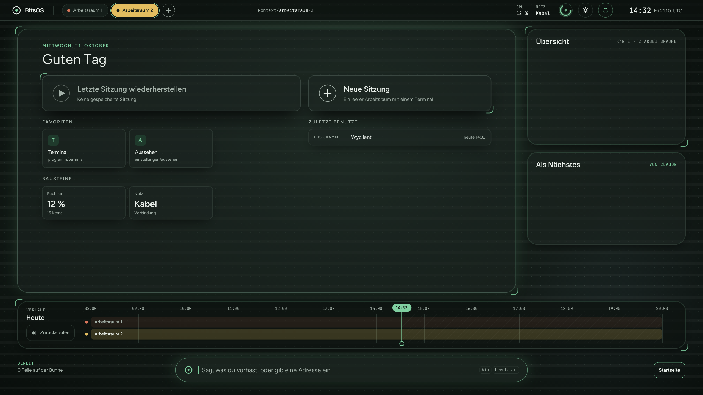
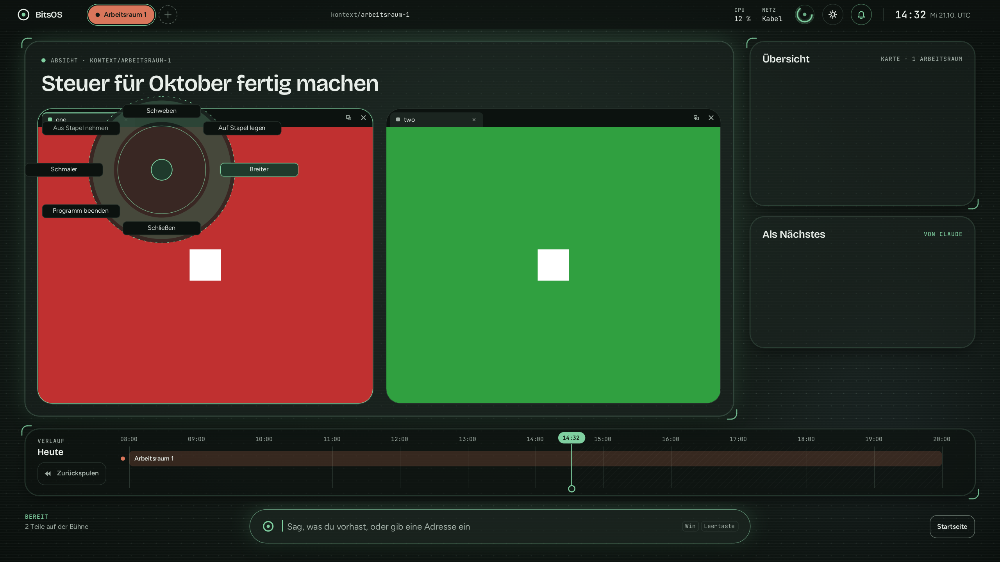
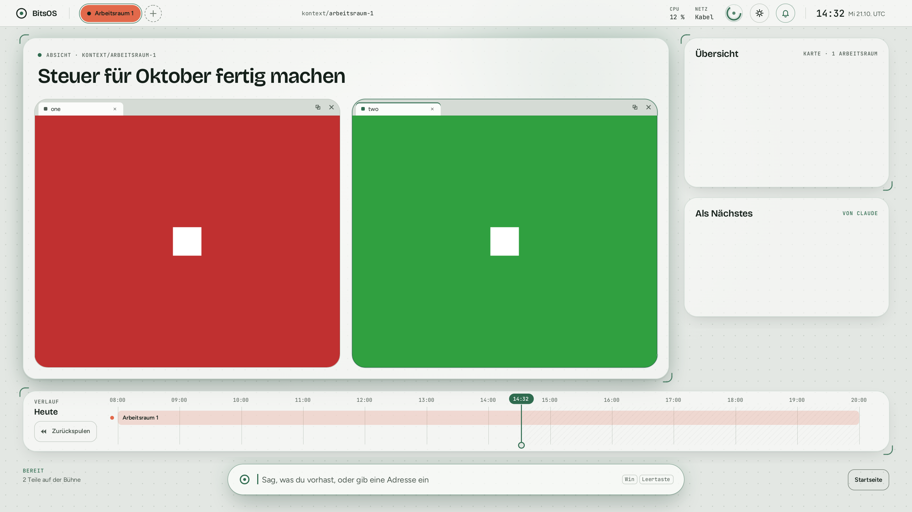

# BitsOS

We have no idea what we're doing.<br>
But it boots.<br>
...and plays sounds.<br>
...and connects to the internet.<br>
...and runs Brave.<br>
...and keeps Brave in a sandbox.<br>
...and opens LibreOffice.<br>
...and shuts down when you type poweroff.<br>
...and survives its own kernel panic.<br>
...and brings up half a GPU.<br>
...and somehow it still boots.

---



BitsOS is a hobby operating system with its own kernel written in Rust. It speaks the Linux system-call
interface, so ordinary Linux programs (BusyBox, a Wayland compositor, the Brave browser, LibreOffice) run on it
unchanged.

It is built by someone who cannot program, together with AI agents (Anthropic's Claude) that write, review and
test the code. A line only goes into the list above once it is true on the real hardware.

## The desktop

These pictures come from the desktop's automated tests in QEMU, so the red and green windows are test programs and
the labels are in German, as on the real machine.

| Ring menu on a window | Light theme |
|---|---|
|  |  |

## What is in it

- **Kernel** (`kernel/`, `crates/`): memory management with a page cache and huge pages, a preemptive scheduler
  for all cores, processes and threads, a VFS with FAT32 and ext4, snapshots of the data volume, a kernel journal,
  seccomp, and user, PID, network and mount namespaces.
- **Drivers**, written for BitsOS: NVMe, xHCI USB (keyboards, mice, mass storage, USB audio), Intel I226 Ethernet,
  Realtek RTL8852BE Wi-Fi with WPA2 (ported from Linux's rtw89, see `NOTICE.md`), HD Audio over HDMI/DisplayPort,
  ACPI, the AMD Radeon 780M display side (page flips, hardware cursor, display audio), and a GPU bring-up that is
  not finished yet (see below).
- **Boot loader** (`boot/bitsboot`): UEFI, a boot menu, generations with automatic fallback to the last good one.
- **User space** (`user/`): init, `bitscomp` (Wayland compositor and desktop), `settingsd`, `bitsjournal`, `ctxd`
  (a local context index), and ports of BusyBox, Brave, Cobalt, ffmpeg, bubblewrap, Xwayland and Mesa.
- **Remote control** (`crates/mcp`, `host/mcp`): an MCP service, so an AI agent on another machine can read logs,
  inspect hardware and install a new generation. It speaks TLS with a key pairing confirmed at the machine's
  keyboard; full access is limited in time and is only granted from that keyboard.
- **Tests** (`host/xtask`, `host/tests`): over 4,000 unit tests, about 1,100 in-kernel tests and QEMU scenarios
  behind one command, plus check lists run on the real machine.

## What changed since the first release (26 October 2026)

"On the Mini PC" means tried on the real hardware. "In QEMU" means only tried in the emulator so far.

### Graphics driver (AMD Radeon 780M)

The goal is Vulkan and OpenGL on the real chip, and then Steam. **The GPU has not drawn a single pixel yet.** On the
Mini PC, with the running picture untouched at every step (no display register written):

- The security processor loads 17 firmware images and starts the graphics block; the power firmware mailbox works.
- System memory is mapped for the chip, and the memory-hub registers match what Linux sets.
- The DMA engine runs rings, fills, copies and fences, including through doorbells.
- The graphics ring runs with ring test, indirect buffers and a 64-bit end-of-pipe fence.
- The scheduler firmware (MES) starts, and graphics and compute queues mapped through it pass their tests.
- A GPU address space works: indirect buffers run in it, and intended faults on the graphics and compute rings are
  decoded and survived.
- The chip can be stopped and started again without a reboot, and across a kernel Reload.

In QEMU: `/dev/dri/renderD128` with the Linux amdgpu interface against a fake 780M, and Mesa's RADV and radeonsi running
against that fake up to their first command submission. Nothing from Mesa reaches the real chip yet.

### Kernel

- Seccomp with BPF and unprivileged namespaces. On the Mini PC Brave's sandbox page is all green and a crashing tab
  stays contained.
- In QEMU: mount namespaces (bind mounts, propagation, `pivot_root`), with the real bubblewrap 0.13.1 passing its test
  suite with the same results as Linux, and pressure-vessel with Steam's runtime starting a program in its container.
- In QEMU: a vDSO, `process_vm_readv/writev`, `kcmp`, Linux's user segment selectors and a per-process LDT, as
  groundwork for Mesa, Wine and Steam.
- Transparent huge pages for private anonymous memory.
- A lost epoll wake-up that made windows look "not responding" is fixed: 20 minutes of Brave playing video on the Mini
  PC with no lost wake-up.
- An AMD `SYSRET` problem under NMIs and several signal and `iretq` races under backtrace storms are fixed.
- TCP and UDP got Linux-style quick ACKs; node, python and wget fetch at about 117 MB/s, gigabit line rate.

### Desktop

- A new design: dark and light themes, a green accent, new fonts, glass bars, and a real boot screen that the desktop
  takes over without a jump.
- In QEMU: a sound popup with volume per output device, and a close button on workspaces.
- The compositor copies only the damaged parts of the screen: about 30 % less CPU on the screen path on the Mini PC.
- In QEMU: a GLES renderer on software OpenGL and `linux-dmabuf` with explicit sync, ready for the GPU.

### Programs

- LibreOffice Writer opened in a window on the Mini PC, and a document was typed and saved. It now comes from the boot
  stick, with Writer and Calc in the desktop's address bar. Its icons are still invisible in the dark theme.
- In QEMU: Xwayland runs X11 programs on the desktop.
- Steam itself has not been started yet.

### Reliability

- A forced kernel panic returns to BitsOS by itself in about two minutes.
- A record that survives a reset names the last step before it; 30 reboot and install rounds ran without a CPU
  sync-flood reset.
- `poweroff` and `reboot` work from the shell and ask the desktop to end first.
- A hung machine resets itself through the watchdog, and a bad new kernel falls back to the last good generation.

### Speed (reads of cached files, against CachyOS on the same machine)

- Large reads now match or beat Linux: 1 MiB reads from 8 threads went from 16,800/s to 151,000/s (Linux 129,000/s).
- Small reads are still behind: 16-byte reads from 8 threads on one file reach 2 M/s against Linux's 11 M/s.

### How it is built

- Zero compiler warnings: nothing ships otherwise. A cleanup round went from over 100 warnings to 0 and removed code
  that only tests reached.
- No test may be skipped: a test that cannot do its work is red. The skips that still exist are being worked off.
- Big third-party programs are tested on the real machine only, not in QEMU.
- After every merge, independent checkers look at the merged whole, not only at each change.

## Hardware

BitsOS is developed and tested on one machine: a mini PC with an AMD Ryzen 7 8845HS, Radeon 780M graphics,
an Intel I226 network card and a Realtek RTL8852BE Wi-Fi card. It boots from a USB stick. Other hardware will
mostly not work yet. QEMU (q35) is used for the automated tests.

## Building

You need Linux, `rustup` (the toolchain in `rust-toolchain.toml` installs itself), QEMU, `mtools`, `mkfs.fat` and
`zstd`. The image takes GPU and Wi-Fi firmware from your system's `linux-firmware` packages.

```sh
cargo xtask test            # the whole test suite (unit, in-kernel, QEMU scenarios)
cargo xtask image           # a bootable image under target/xtask/
cargo xtask qemu            # boot it in QEMU
```

`cargo xtask stick` writes a USB stick, and only a stick whose ID you recorded in `stick.id`.
BitsOS never writes to internal disks unless `nvme_write=on` is set in the stick's `config.txt`.

## Status

This is a hobby project and an experiment in building a whole OS with AI agents. It is not secure, not stable and
not meant for anything important. Expect things to break.

## Licence

MIT OR Apache-2.0, at your option. Third-party parts and their notices are listed in `NOTICE.md`.
